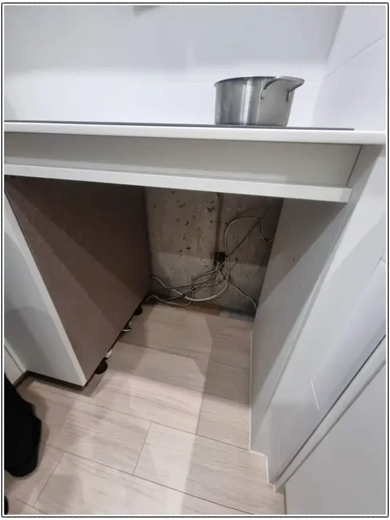
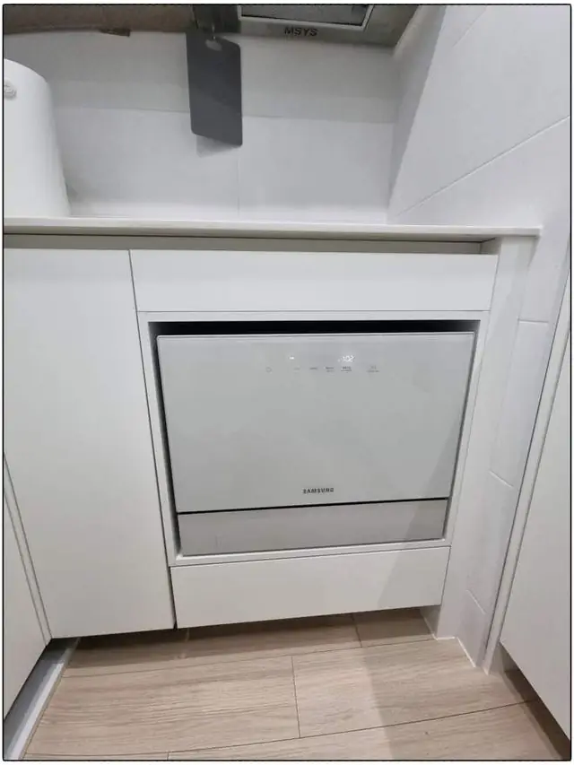

## 한 줄로 정리하면

- 주방을 깔끔하게 쓰고 싶고 하부장 한 칸을 비울 수 있다면 **빌트인**이 가장 많이 하는 방식이에요.
- 하부장을 건드리기 싫거나 전세라면 **프리스탠딩**이나 **6인용 상판형**이 부담이 적어요.
- 어떤 방식이든 **급수·배수·전원 위치**를 먼저 봐야 해요. 여기서 작업 범위가 정해져요.
- 쓰던 식기세척기를 빼는 경우엔 **빈자리를 수납장으로 채우는 것**까지 생각해 두세요.

## 세 가지 방식, 무엇이 다른가요?

식기세척기는 크게 세 가지로 놓아요. 하부장 안에 쏙 넣어 문짝만 보이게 하는 **빌트인**, 바닥에 세워 두는 **프리스탠딩**, 그리고 싱크대 상판 위에 올려 쓰는 작은 **상판형(6인용 등)**이에요. 제품 크기보다 더 중요한 건 **주방 구조**예요. 싱크대 밑 배관이 어디 있는지, 콘센트가 가까운지에 따라 같은 제품도 작업이 완전히 달라집니다.

## 빌트인: 하부장 한 칸을 비워서 넣어요

가장 깔끔한 방식이에요. 기존 하부장 한 칸의 문과 선반을 떼고, 제품 크기에 맞게 **하부장을 리폼**해서 넣습니다. 싱크대 바로 옆 칸이면 급수·배수 연결이 짧아져 작업이 수월해요. [6인용 식기세척기를 하부장에 빌트인한 사례](/cases/kitchen-224369216537/)처럼 작은 제품도 빌트인이 돼요.

> 하부장 안에 **배관이나 걸레받이**가 걸리면 그 부분을 따로 손봐야 해요. 하부장 안쪽 사진을 함께 보내 주시면 미리 알려드려요.

## 프리스탠딩: 공간만 있으면 바로

옆에 빈 바닥 자리가 있으면 그냥 세워 두고 급수·배수만 연결하면 돼요. 하부장을 건드리지 않아 이사 갈 때 그대로 가져가기 좋습니다. 대신 바닥 자리를 하나 차지하고, 싱크대에서 멀면 호스가 길어져요.

## 6인용 상판형: 작은 주방, 1~2인 가구

싱크대 위에 올려 쓰는 작은 제품이에요. 하부장 공사가 없고, 싱크대 수전 쪽에서 물을 받아 씁니다. 자리를 정하고 [급수·배수를 싱크대에 연결한 사례](/cases/kitchen-224343957645/)처럼 물이 새지 않게 연결해 두면 편하게 써요. 다만 상판 위 작업 공간이 그만큼 줄어요.

## 한눈에 비교

| 방식 | 이런 집에 맞아요 | 미리 볼 것 |
| --- | --- | --- |
| 빌트인 | 주방을 깔끔하게, 하부장 한 칸을 비울 수 있는 집 | 하부장 폭·깊이, 배관 위치, 리폼 여부 |
| 프리스탠딩 | 하부장을 건드리기 싫은 집, 바닥 자리가 남는 집 | 싱크대까지 거리, 콘센트 |
| 6인용 상판형 | 작은 주방, 1~2인 가구, 전세 | 상판 위 자리, 수전 연결 방식 |

## 설치 전에 준비하면 좋은 것

1. 식기세척기 **모델명** (빌트인용인지 꼭 확인)
2. 넣을 자리 하부장의 **폭·깊이·높이**
3. 싱크대 밑 **배관 사진** (문 열고 한 장)
4. 근처 **콘센트 위치**

## 쓰던 식기세척기를 뺄 때

이사나 고장으로 식기세척기를 빼면 하부장 한 칸이 텅 비고, 급수·배수 자리가 남아요. 그냥 두면 물이 샐 수 있어서 **배관을 막고**, 같은 규격 수납장을 만들어 채우는 게 깔끔해요. 자세한 내용은 [식기세척기 철거 후 하부장 복원](/repair/dishwasher-removal/)에 정리해 두었어요.

## 자주 묻는 질문

### 6인용 식기세척기도 빌트인이 되나요?
네. 하부장을 제품 크기에 맞게 리폼해서 넣은 사례가 있어요. 제품 모델명과 하부장 사진을 보내 주시면 가능한지 먼저 봐 드려요.

### 급수·배수 연결도 해 주시나요?
네. 싱크대 급수와 배수에 연결하고 물을 돌려 새지 않는지 확인한 뒤 마무리해요.

### 하부장을 잘라야 하나요?
제품 크기와 하부장 구조를 보고 정해요. 자르거나 리폼해야 하면 견적에 미리 넣어 드려요.

### 견적은 어떻게 받나요?
주방 사진(하부장 문 열고 한 장 포함)과 동네를 문자(010-3051-8015)로 보내 주시면 설치 방법과 예상 금액을 먼저 알려드려요.
