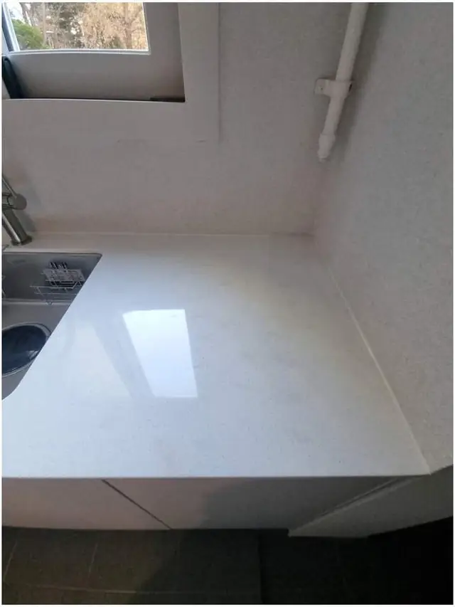
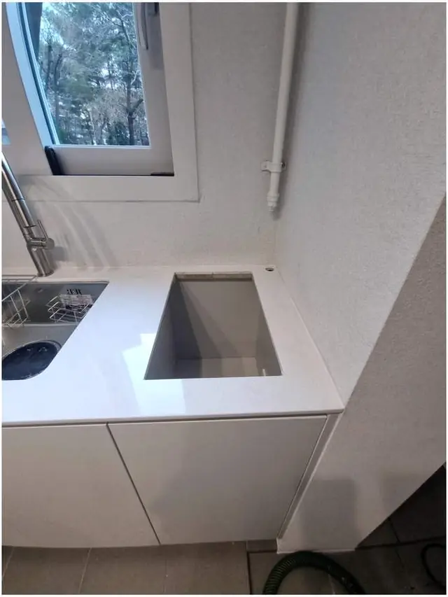

## 한 줄로 정리하면

- 가스레인지와 인덕션은 **상판에 뚫는 구멍 크기(타공 규격)**가 달라서 그대로는 안 들어가는 경우가 많아요.
- 구멍이 **작으면** 상판을 더 잘라 넓히고, **크면** 받침이나 메꿈으로 맞춰요.
- 인덕션은 전기를 많이 써서 **전용 콘센트**가 필요할 수 있어요. 모델명으로 미리 확인하세요.
- 제품이 오기 전에 **규격만 알면** 자리를 먼저 만들어 둘 수 있어요.

## 왜 구멍이 안 맞나요?

빌트인 가스레인지와 인덕션은 회사마다, 모델마다 **타공 규격**이 달라요. 그래서 "같은 3구니까 그냥 들어가겠지" 하고 샀다가 상판 구멍이 몇 센티 작아서 안 들어가는 일이 정말 많습니다. 설명서나 제품 상세 페이지에 나온 **타공 치수(가로×세로)**를 지금 상판 구멍과 비교해 보는 게 첫 단계예요.

## 구멍이 작을 때: 상판을 더 잘라요

가장 흔한 경우예요. 절단선을 테이프로 표시하고, 먼지가 날리지 않게 주변을 덮은 다음 **정밀하게 잘라 넓혀요.** 자른 면과 모서리는 매끈하게 다듬어 마무리합니다. [대리석 상판에 쿡탑 자리를 새로 낸 사례](/cases/kitchen-224365691797/)도 이 순서로 했어요.

> 대리석은 잘못 자르면 **금이 가거나 모서리가 깨질 수** 있어요. 상판 재질(인조·천연)과 두께에 맞는 날로, 무리하지 않게 잘라야 해요.

## 구멍이 클 때: 받침이나 메꿈으로 맞춰요

반대로 기존 구멍이 더 크면 인덕션 테두리가 걸치지 못해요. 이럴 땐 안쪽에 받침을 대거나 남는 부분을 메워 크기를 맞춥니다. 상판 색에 가깝게 마무리하면 겉에서 잘 보이지 않아요.

## 한눈에 비교

| 상황 | 하는 작업 | 확인할 것 |
| --- | --- | --- |
| 기존 구멍이 작음 | 상판 추가 절단, 모서리 다듬기 | 타공 치수, 상판 재질·두께 |
| 기존 구멍이 큼 | 받침 보강, 메꿈·색 맞춤 | 테두리 걸침 폭 |
| 새로 구멍을 냄 | 위치 표시 후 절단 | 하부장 속 서랍·배관 간섭 |

## 바꾸기 전에 꼭 확인할 것

1. 새 인덕션 **모델명과 타공 치수**
2. 지금 상판 구멍 **가로·세로** (줄자로 재서 사진에 같이 찍으면 좋아요)
3. 상판 **재질** (인조대리석인지 천연석인지 모르면 사진으로 봐 드려요)
4. 하부장 안 **콘센트 위치**와 차단기 여유
5. 기존 가스레인지 **철거와 가스 마감**이 필요한지

## 전기는 괜찮을까요?

인덕션은 순간적으로 전기를 많이 써서, 제품에 따라 **전용 콘센트(전용 회로)**를 권하는 경우가 있어요. 멀티탭에 꽂아 쓰면 위험할 수 있습니다. 모델명을 보내 주시면 설치 전에 같이 확인해 드려요.

## 자주 묻는 질문

### 대리석 상판을 자르다 깨지지 않나요?
절단선을 표시하고 재질에 맞게 정밀하게 자른 뒤 모서리까지 다듬어요. 금이 이미 가 있는 상판은 미리 말씀드려요.

### 인덕션이 아직 배송 전인데 미리 작업할 수 있나요?
네. 모델명이나 타공 치수만 알려 주시면 도착 전에 자리를 만들어 둘 수 있어요.

### 기존 가스레인지 철거도 같이 되나요?
네. 철거와 가스 마감 확인, 상판 절단, 인덕션 설치까지 한 번에 진행해요.

### 견적은 어떻게 받나요?
상판 구멍 사진(줄자 같이)과 인덕션 모델명, 동네를 문자(010-3051-8015)로 보내 주시면 예상 금액을 먼저 알려드려요.
