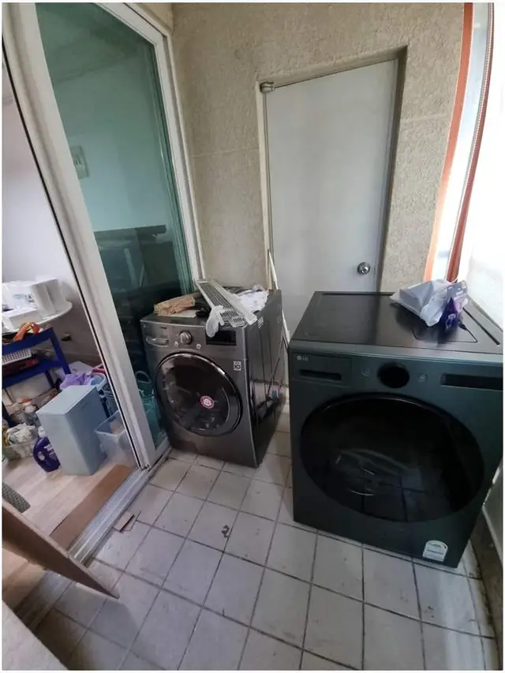
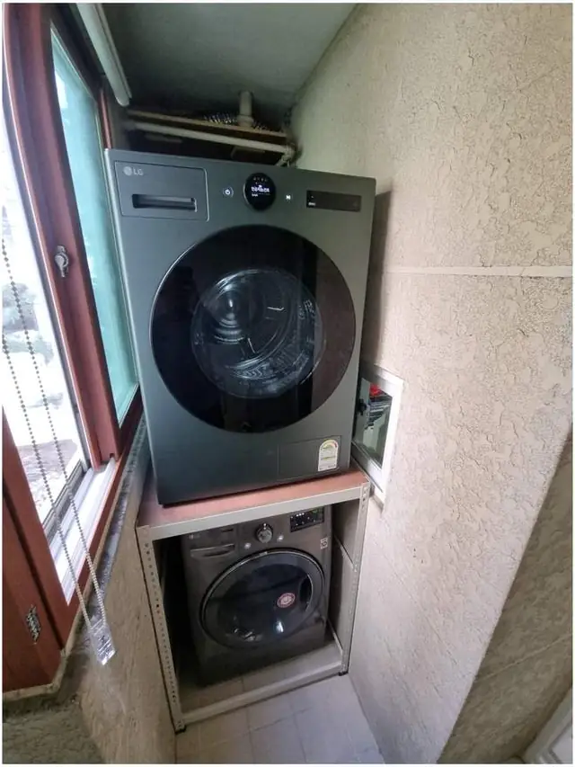
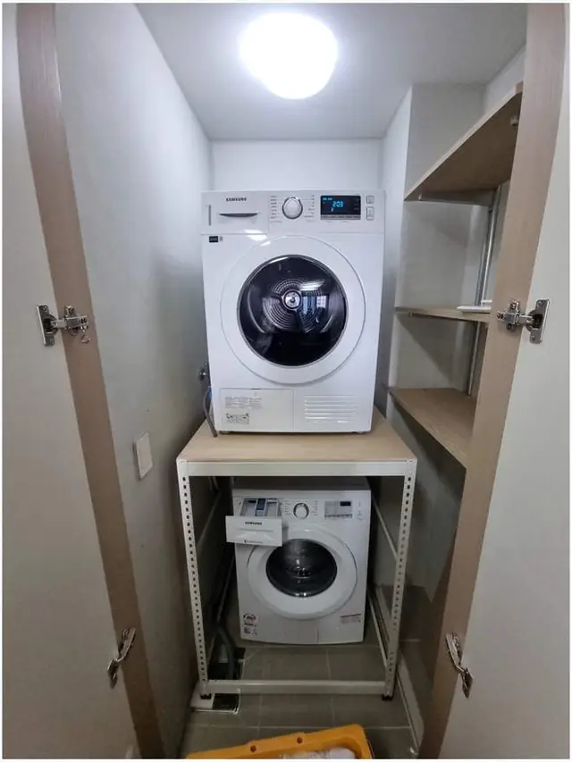

## 한 줄로 정리하면

- 세탁기와 건조기가 **같은 브랜드의 드럼 제품**이면 제조사 **직렬 키트**로 바로 올릴 수 있어요.
- 브랜드가 다르거나 **통돌이 세탁기** 위에 올려야 하면 바닥에 서는 **건조기랙**이 답이에요.
- 세탁실 벽에 오래된 **선반이 있으면** 떼어 내고 랙을 세우는 경우가 많아요. 약한 선반에 건조기를 그냥 올리면 위험해요.
- 어떤 방법이든 마지막에 **수평과 흔들림**을 직접 확인하는 게 제일 중요해요.

## 건조기를 왜 위로 올리나요?

아파트 세탁실이나 베란다는 폭이 좁은 곳이 많아요. 세탁기와 건조기를 나란히 두려면 보통 폭이 1.3m 넘게 필요한데, 그만한 자리가 안 나오는 집이 많습니다. 그래서 세탁기 위로 건조기를 올려 **한 자리에 위아래로** 두는 방법을 많이 찾으세요. 바닥 자리가 하나 남으니 빨래 바구니나 수납장을 둘 수 있고, 세탁실 문도 편하게 열립니다.

## 방법 1. 직렬 키트: 같은 브랜드 드럼끼리

세탁기와 건조기를 같은 회사, 맞는 모델로 샀다면 제조사에서 파는 **직렬 키트(적재 키트)**를 쓸 수 있어요. 세탁기 윗면에 건조기를 바로 얹고 미끄러지지 않게 잡아 주는 부품입니다. 따로 구조물이 없어 깔끔하지만, 모델이 맞아야 하고 **통돌이 세탁기 위에는 쓸 수 없어요.** 통돌이는 뚜껑이 위로 열리기 때문이에요.

## 방법 2. 건조기랙: 브랜드가 달라도, 통돌이여도

건조기랙은 세탁기를 감싸듯 바닥에 네 다리로 서는 철제 구조물이에요. 건조기 무게를 세탁기가 아니라 **랙이 받기 때문에** 세탁기 브랜드나 종류와 상관없이 쓸 수 있어요. 통돌이 세탁기 위에 건조기를 두고 싶을 때도 랙 높이를 넉넉하게 잡아 뚜껑이 열릴 공간을 남기면 됩니다.

랙은 높이와 폭이 정해져 있어서 **세탁기 높이, 문 여는 공간, 천장 높이**를 먼저 재야 해요. 높이를 잘못 고르면 건조기 문이 머리 위로 올라가 빨래를 꺼내기 불편해집니다. [통돌이 위 건조기 랙 사례](/cases/laundry-224315290440/)처럼 현장마다 높이를 맞춰 세워요.

## 방법 3. 벽 선반: 이미 있다면 상태부터 확인

예전 아파트에는 세탁기 위 벽에 선반이 붙어 있는 경우가 있어요. 문제는 그 선반이 **건조기 무게를 생각하고 만든 게 아닌 경우**가 많다는 점이에요. 건조기는 그 자체로도 무겁고, 돌아갈 때 진동까지 생깁니다. 선반이 처져 있거나 흔들리면 떼어 내고 랙을 세우는 쪽이 안전해요. 실제로 [벽 선반을 철거하고 건조기 랙을 세운 사례](/cases/laundry-224348238887/)가 꽤 많습니다.

## 한눈에 비교

| 방법 | 이런 집에 맞아요 | 주의할 점 |
| --- | --- | --- |
| 직렬 키트 | 같은 브랜드, 맞는 모델의 드럼 세탁기·건조기 | 통돌이 불가, 모델이 맞아야 함 |
| 건조기랙 | 브랜드가 다르거나 통돌이 세탁기, 좁은 세탁실 | 높이·폭을 미리 재야 함 |
| 기존 벽 선반 | 선반이 튼튼하게 고정돼 있을 때만 | 처지거나 흔들리면 철거 후 랙 |

## 설치 전에 재 두면 좋은 것

1. 세탁기 **가로·세로·높이** (모델명만 알려 주셔도 돼요)
2. 건조기 **모델명**
3. 세탁실 **폭과 깊이**, 바닥에서 천장(또는 수도꼭지·창틀)까지 **높이**
4. 벽에 **기존 선반**이 있는지, 바닥에 **턱이나 배수구**가 있는지

사진을 찍을 때는 세탁실 전체가 보이게 멀리서 한 장, 세탁기 옆 공간이 보이게 가까이서 한 장이면 충분해요.

## 좁아서 건조기가 안 들어갈 것 같을 때

건조기는 무겁고 부피가 커서, 문이 좁거나 꺾인 세탁실은 사람이 들고 들어가기도 쉽지 않아요. 이런 곳은 랙을 먼저 세우고 건조기를 올리는 순서, 들어 올리는 각도를 미리 정한 뒤 작업합니다. [사람이 들기 힘든 좁은 세탁장 사례](/cases/laundry-224337708271/)도 그렇게 마무리했어요.

## 설치가 끝나면 꼭 확인하는 것

> 랙과 건조기의 **수평**을 맞추고, 손으로 힘을 실어 **흔들림**이 없는지 확인해요.
> 건조기 문과 세탁기 문(뚜껑)이 **끝까지 열리는지** 열어 봐요.
> 배기·배수 호스와 전원선이 **눌리거나 꺾이지 않았는지** 봐요.

## 자주 묻는 질문

### 세탁기와 건조기 브랜드가 달라도 위로 올릴 수 있나요?
네. 브랜드가 다르면 직렬 키트 대신 바닥에 서는 건조기랙을 쓰면 돼요. 두 제품 모델명을 알려 주시면 맞는 크기를 골라 드려요.

### 통돌이 세탁기 위에도 건조기를 올릴 수 있나요?
건조기랙으로 올릴 수 있어요. 통돌이는 뚜껑이 위로 열리기 때문에 랙 높이를 넉넉하게 잡아 뚜껑 열 공간을 남겨요.

### 건조기가 돌아갈 때 흔들리지 않을까요?
설치할 때 수평을 맞추고 직접 힘을 실어 흔들림을 확인한 뒤 마무리해요. 기존 선반이 약하면 떼어 내고 새로 세우는 쪽을 권해요.

### 견적은 어떻게 받나요?
세탁실 사진 1~2장과 동네를 문자(010-3051-8015)로 보내 주시면 설치 방법과 예상 금액을 먼저 알려드려요. 서울·경기 전 지역에 출장 가요.
