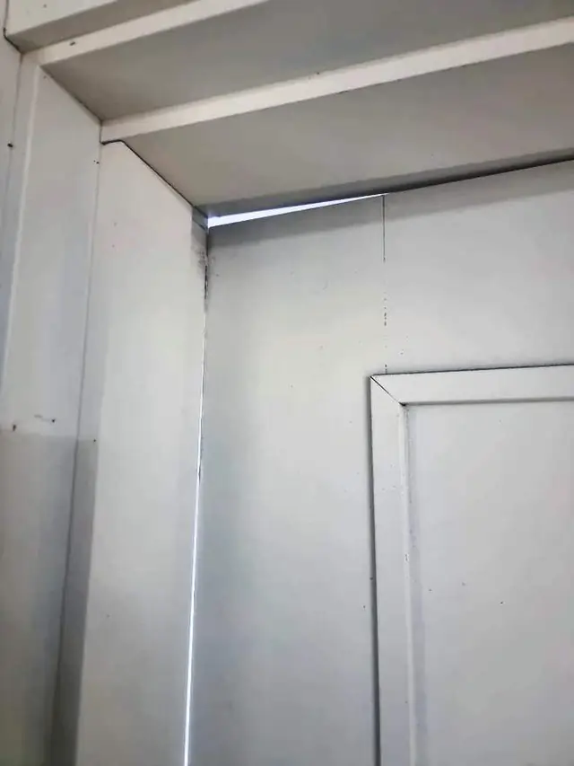
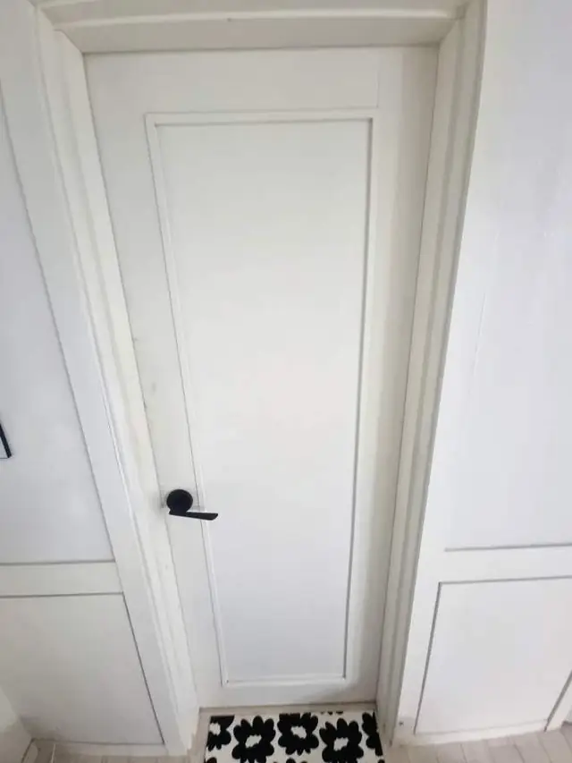

## 한 줄로 정리하면

- 화장실 문이 처지는 건 대부분 **경첩이 닳았거나 나사 구멍이 헐거워져서**예요.
- 문 위쪽 경첩 나사를 조여 봐서 **헛돌면** 나사 구멍 보강이 필요해요.
- 문짝이 멀쩡하면 **부품만 바꿔서** 고쳐요. 문을 새로 살 일은 많지 않아요.
- 문틀 아래가 **물에 젖어 부풀었으면** 그 부분 보수까지 함께 봐야 해요.

## 화장실 문은 왜 유독 잘 처질까요?

화장실은 습기가 많아요. 문짝과 문틀이 물기를 먹었다 말랐다를 반복하면서 **나사가 박힌 나무가 약해지고**, 무거운 문을 버티던 경첩도 조금씩 벌어집니다. 그러면 문 끝이 내려앉아 바닥에 긁히고, 문틀에 걸려 '딸깍' 하고 닫히지 않게 돼요.

## 집에서 원인 확인하는 법

1. 문을 반쯤 열고 **문 손잡이 쪽을 위로 살짝 들어 보세요.** 덜컹 움직이면 경첩이나 나사가 헐거운 거예요.
2. 위쪽 경첩 나사를 드라이버로 **조여 보세요.** 조여지면 일단 해결, 헛돌면 나사 구멍이 망가진 거예요.
3. 경첩 날개가 **휘었거나 녹슬었는지** 보세요.
4. 문틀 아래쪽이 **들뜨거나 부풀었는지** 보세요. 물에 상한 흔적이에요.

> 나사가 헛도는데 더 긴 나사로 억지로 박으면 **문틀이 갈라질 수** 있어요. 구멍을 먼저 보강하고 다시 박아야 오래가요.

## 원인별로 이렇게 고쳐요

| 증상 | 원인 | 고치는 법 |
| --- | --- | --- |
| 나사를 조이면 괜찮아짐 | 나사가 풀림 | 조임, 상태 보고 마무리 |
| 나사가 헛돎 | 나사 구멍이 망가짐 | 구멍 보강 후 다시 고정 |
| 경첩이 휘거나 녹슮 | 경첩 마모 | 같은 규격 경첩으로 교체 |
| 문틀이 들뜨고 부풂 | 습기로 문틀 손상 | 상한 부분 보수 후 경첩 |

[화장실 문 경첩 교체 사례](/cases/door-224424459908/)도 위쪽 경첩이 벌어지면서 문이 내려앉은 경우였어요. 경첩을 바꾸고 문 높이와 수평을 맞춘 뒤, 여러 번 여닫아 걸리는 곳이 없는지 확인하고 마무리했습니다.

## 문틀까지 상했다면

문틀이 깨지고 들떠서 지저분하면 경첩만 바꿔도 금방 다시 처질 수 있어요. 상한 부분을 정리하고 보수한 뒤에 경첩을 다는 게 순서예요. 겉이 보기 싫다면 [문틀 필름으로 깔끔하게 마무리한 사례](/cases/door-224372308194/)처럼 함께 손볼 수도 있어요.

## 자주 묻는 질문

### 경첩만 바꾸면 되나요?
대부분은 경첩 교체와 나사 구멍 보강으로 해결돼요. 문짝이 뒤틀렸거나 문틀이 상했으면 사진을 보고 미리 말씀드려요.

### 문짝을 새로 사야 하나요?
문짝이 멀쩡하면 그대로 쓰고 부품만 바꿔요.

### 경첩 규격을 몰라도 되나요?
네. 문 옆면과 경첩이 보이게 사진을 보내 주시면 맞는 규격을 찾아 준비해 가요.

### 견적은 어떻게 받나요?
문 전체 사진 한 장, 경첩 가까이 한 장과 동네를 문자(010-3051-8015)로 보내 주시면 예상 금액을 먼저 알려드려요.
