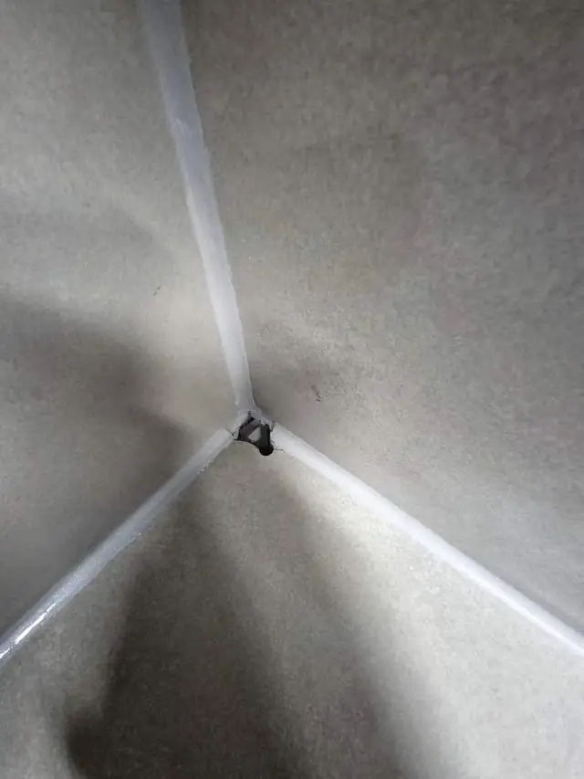
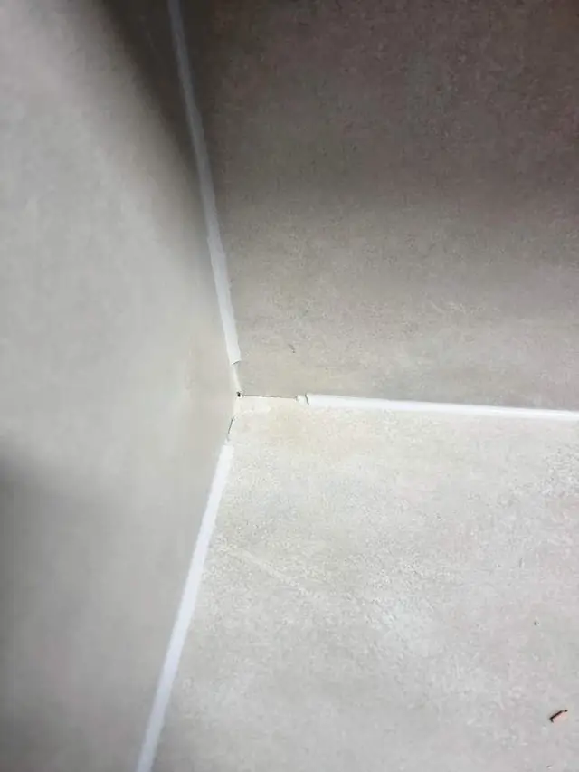

## 한 줄로 정리하면

- 정수기 구멍은 **상판을 통째로 바꾸지 않고** 메울 수 있어요.
- 그냥 두면 **물이 하부장으로 스며들어** 나무가 붓거나 곰팡이가 생길 수 있어요.
- 인조대리석 상판은 **비슷한 색으로 메우고 갈아서** 표면을 맞춰요.
- 무늬나 오래된 변색이 있으면 **완전히 똑같지는 않을 수** 있어서, 사진을 보고 미리 말씀드려요.

## 정수기를 빼면 왜 구멍이 남나요?

직수형 정수기나 별도 수전을 달 때 상판에 동그란 구멍을 뚫어 꼭지를 고정해요. 정수기를 해지하거나 바꾸면 그 구멍이 그대로 남습니다. 작은 고무 마개로 막아 두는 집도 많은데, 틈으로 물이 들어가기 쉽고 보기에도 신경 쓰여요.

## 어떻게 메우나요?

1. 구멍 **크기와 상판 재질**을 확인해요.
2. 구멍 **안쪽에 받침**을 대서 메꿈재가 아래로 빠지지 않게 해요.
3. 상판 색에 가까운 **메꿈재로 채워요.**
4. 굳으면 **갈아서 높이를 맞추고** 광을 내 마무리해요.

[정수기 구멍 복원 사례](/cases/kitchen-224387214880/)도 이 순서로 작업했어요. 상판을 바꾸지 않아서 하루 안에 끝나고, 주방을 오래 비울 필요가 없어요.

## 상판 재질에 따라 달라요

| 상판 | 메우는 방법 | 참고 |
| --- | --- | --- |
| 인조대리석 | 색 맞춘 메꿈재 + 연마 | 가장 자연스럽게 복원돼요 |
| 천연석 | 무늬에 맞춰 메꿈 | 무늬가 강하면 티가 날 수 있어요 |
| 스테인리스 | 재질에 맞는 방법을 따로 | 사진 보고 가능한 방법 안내 |

> 오래 쓴 상판은 햇빛이나 세제 때문에 **원래 색에서 조금 바래** 있어요. 새 메꿈재와 미세하게 차이가 날 수 있어서, 사진으로 먼저 보고 어느 정도인지 말씀드려요.

## 상판에 다른 구멍이나 금도 있다면

정수기 구멍 말고도 수전 자리, 깨진 모서리, 가는 금이 함께 있는 집이 많아요. 한 번 갈 때 같이 손보면 따로 부르는 것보다 편해요. [인조대리석 상판 복원](/repair/countertop-repair/)에 크랙·깨짐 보수도 정리해 두었어요.

## 자주 묻는 질문

### 정수기 철거도 같이 해 주시나요?
네. 정수기 철거부터 구멍 메꿈까지 한 번에 해요.

### 메운 자리에 물이 닿아도 괜찮나요?
완전히 굳은 뒤에는 평소처럼 쓰시면 돼요. 언제부터 써도 되는지는 작업 후에 알려드려요.

### 스테인리스 상판도 메울 수 있나요?
재질에 따라 방법이 달라서, 사진을 보고 가능한 방법을 먼저 말씀드려요.

### 견적은 어떻게 받나요?
구멍 가까이 한 장, 상판 전체 한 장과 동네를 문자(010-3051-8015)로 보내 주시면 예상 금액을 먼저 알려드려요.
