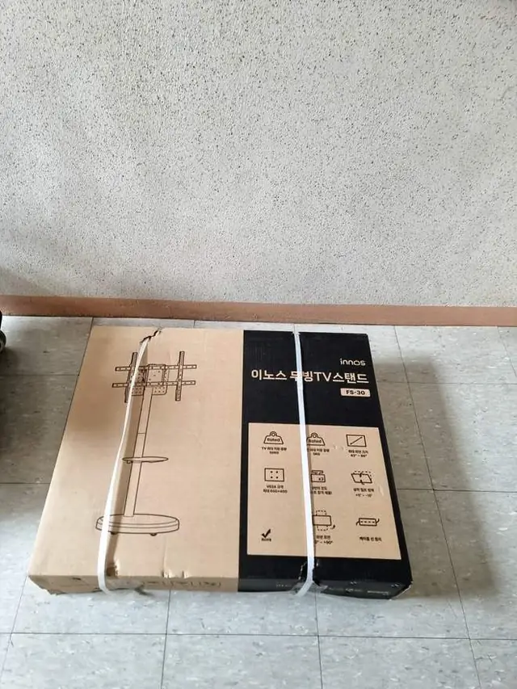
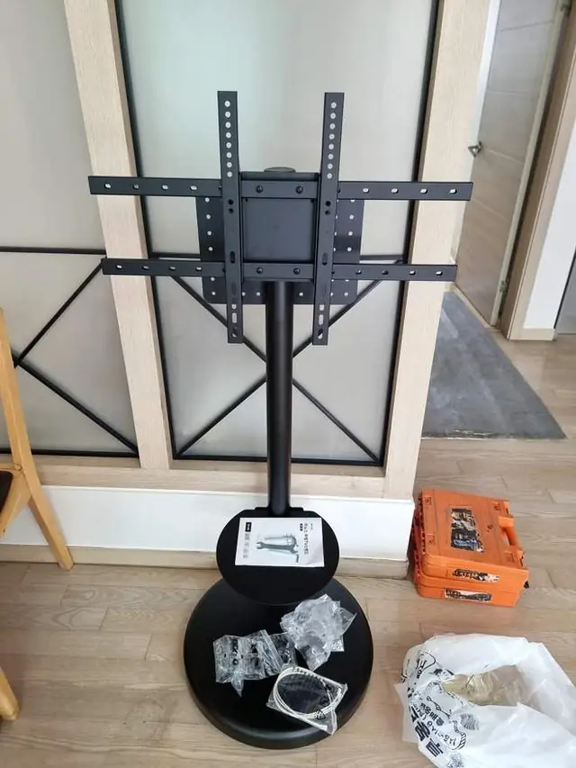

## 한 줄로 정리하면

- 벽이 튼튼하고 구멍을 내도 되는 집이면 **벽걸이**가 가장 깔끔해요.
- 전세이거나 벽이 약하면 바닥에 세우는 **스탠드 거치대**로 벽 구멍 없이 설치할 수 있어요.
- TV가 클수록 **벽 재질과 고정 위치** 확인이 더 중요해요.
- 어느 쪽이든 설치 뒤 **흔들림과 수평**을 꼭 확인해야 해요.

## 벽걸이와 스탠드, 무엇이 다른가요?

벽걸이는 벽에 브래킷을 고정하고 TV를 거는 방식이에요. 바닥 자리를 차지하지 않아 거실이 넓어 보이지만, **벽에 구멍**을 내야 하고 벽이 TV 무게를 버텨야 해요. 스탠드 거치대는 바닥에 받침을 두고 기둥에 TV를 거는 방식이라 **벽을 건드리지 않아요.** 이사할 때 그대로 가져갈 수 있는 것도 장점이에요.

## 벽걸이가 맞는 집

콘크리트 벽처럼 단단한 벽이면 벽걸이가 잘 맞아요. 반대로 **석고보드 가벽**이나 **아트월 타일**은 그냥 박으면 버티지 못하거나 깨질 수 있어서, 안쪽 구조를 보고 고정 위치를 정해야 해요. 벽을 두드려 봤을 때 통통 빈 소리가 나면 사진과 함께 알려 주세요.

## 스탠드가 맞는 집

전세집, 벽이 약한 집, 벽에 배선이 지나가 구멍 내기 걱정되는 집에 맞아요. [벽에 구멍 없이 TV를 세운 사례](/cases/tv-224407277752/)처럼 받침을 단단히 놓고 높이를 맞추면 벽걸이처럼 깔끔하게 쓸 수 있어요. [86인치 대형 TV를 올린 사례](/cases/tv-224325843811/)도 있어요.

> 큰 TV는 혼자 들기 어렵고 화면이 얇아 **잘못 들면 패널이 휘어** 고장 날 수 있어요. 설치는 꼭 두 사람 이상이 들어서 해요.

## 한눈에 비교

| 방식 | 이런 집에 맞아요 | 주의할 점 |
| --- | --- | --- |
| 벽걸이 | 단단한 벽, 거실을 넓게 쓰고 싶은 집 | 벽 재질 확인, 벽에 구멍이 남음 |
| 스탠드 거치대 | 전세, 약한 벽, 구멍 내기 싫은 집 | 바닥 자리 필요, 받침 수평 |

## 설치 전에 준비하면 좋은 것

1. TV **모델명** (인치와 무게, 뒷면 나사 간격 확인용)
2. 설치할 **벽 사진**과 벽을 두드렸을 때 소리
3. 콘센트·셋톱박스 **선 위치**
4. 원하는 **화면 높이** (소파에 앉았을 때 눈높이 기준)

## 자주 묻는 질문

### 전세집인데 벽에 구멍 없이 TV를 둘 수 있나요?
네. 바닥에 세우는 스탠드 거치대로 벽을 건드리지 않고 설치할 수 있어요.

### 아트월 타일에도 벽걸이를 달 수 있나요?
타일과 안쪽 벽 상태에 따라 달라요. 사진을 보고 가능한지, 다른 방법이 나은지 먼저 말씀드려요.

### 86인치 같은 대형 TV도 되나요?
네. 대형 TV도 설치한 사례가 있어요. 모델명을 알려 주시면 맞는 거치대를 확인해요.

### 견적은 어떻게 받나요?
설치할 자리 사진과 TV 모델명, 동네를 문자(010-3051-8015)로 보내 주시면 예상 금액을 먼저 알려드려요.
