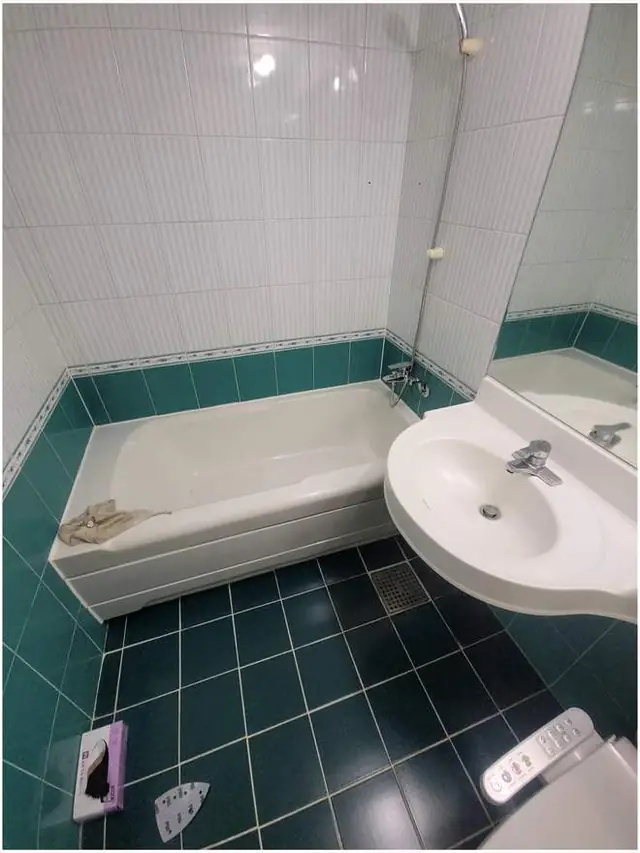
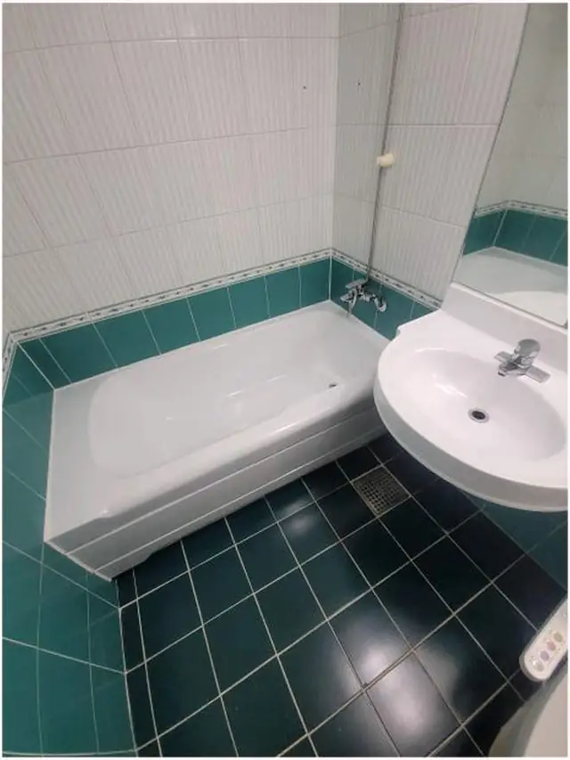

## 한 줄로 정리하면

- 욕조 **겉면의 기스, 누런 얼룩, 광택이 죽은 것**은 뜯지 않고 **코팅 복원**으로 새것처럼 만들 수 있어요.
- **작게 깨지거나 찍힌 곳**도 메운 뒤 코팅하면 대부분 표가 잘 안 나요.
- 욕조에 **금이 가서 물이 새거나, 바닥이 꺼지고 출렁이면** 코팅보다 교체가 맞아요.
- 욕조를 뜯으면 둘레 타일까지 손봐야 해서, 표면 문제라면 **코팅이 훨씬 간단**해요.

## 욕조, 왜 이렇게 지저분해질까요?

욕조는 매일 물과 세제, 때에 닿아요. 오래 쓰면 겉면의 매끈한 막이 닳으면서 **잔기스가 생기고**, 그 기스 사이로 때가 끼어 **닦아도 안 지워지는 누런 얼룩**이 돼요. 무거운 샴푸통이나 샤워기 헤드를 떨어뜨려 **찍힌 자국**이 생기기도 하고요. 이런 건 욕조 자체가 망가진 게 아니라 **겉면이 상한 것**이라 겉면만 새로 입히면 돼요.

## 코팅으로 되는 경우, 교체해야 하는 경우

**코팅으로 되는 경우**
- 잔기스가 많고 **광택이 없어진** 욕조
- 세제로 닦아도 **누런 얼룩**이 남는 욕조
- **찍히거나 작게 깨진** 곳이 몇 군데 있는 욕조

**교체를 권하는 경우**
- 욕조에 **금이 가서 그 틈으로 물이 새는** 경우
- 들어가 서면 바닥이 **출렁이거나 꺼지는** 경우
- 욕조를 아예 빼고 **샤워 공간으로 바꾸고 싶을** 때

금이 간 곳이 있어도 **물이 새지 않는 작은 균열**이면 보수 후 코팅이 될 때가 있어요. 사진을 보고 어느 쪽이 맞는지 안내해 드려요.

## 코팅 복원은 이런 순서로 해요

1. 욕조 겉면의 때와 비누 찌꺼기를 **깨끗이 닦아 내요.**
2. 찍히거나 깨진 곳을 **메우고 평평하게** 다듬어요.
3. 코팅이 잘 붙도록 겉면을 **고르게 갈아** 정리해요.
4. 수전·배수구·둘레 타일에 묻지 않게 **가려 두고** 코팅해요.
5. 코팅이 마를 시간 동안 물을 쓰지 않고, **언제부터 쓸 수 있는지** 알려드려요.

자세한 과정은 [욕조 코팅 복원 사례](/cases/bath-224353976750/)에서 사진으로 볼 수 있어요.

## 한눈에 비교

| 방법 | 이런 욕조에 맞아요 | 알아 둘 점 |
| --- | --- | --- |
| 부분 보수 | 찍힘·깨짐이 한두 군데 | 기존 색과 미세하게 다를 수 있음 |
| 전체 코팅 | 잔기스·얼룩·광택 죽음 | 마를 때까지 사용 못 함 |
| 욕조 교체 | 금으로 물이 샘, 바닥 출렁임 | 둘레 타일·벽까지 손봐야 함 |

## 코팅한 욕조 오래 쓰려면

- **수세미나 거친 솔**로 문지르지 말고 부드러운 스펀지로 닦아 주세요.
- **강한 약품을 오래 올려 두지** 마세요. 겉면이 상할 수 있어요.
- 샴푸통이나 무거운 물건을 **욕조 끝에 올려 두지** 않는 게 좋아요.
- 욕조 둘레 실리콘이 까맣다면 이번에 [실리콘 재시공](/k/bathroom-silicone/)도 함께 하면 훨씬 깔끔해 보여요.

## 사진 보내실 때 준비할 것

1. 욕조 **전체가 보이게** 한 장
2. 기스·얼룩·깨진 곳 **가까이서** 한 장
3. 물이 새는 것 같은 곳이 있는지, 바닥이 **출렁이는지**
4. 전체 코팅을 원하시는지, **깨진 곳만** 원하시는지

## 자주 묻는 질문

### 욕조를 안 뜯어도 되나요?
겉면 손상이면 뜯지 않고 그 자리에서 복원해요. 금으로 물이 새는 경우에만 교체를 권해요.

### 색이 달라 보이지 않나요?
기존 욕조 색에 맞춰 작업해요. 오래돼 변색된 욕조는 부분 보수만 하면 차이가 날 수 있어서, 그럴 땐 미리 말씀드려요.

### 작업 뒤 언제부터 쓸 수 있나요?
코팅이 마르는 시간이 필요해요. 작업이 끝나면 언제부터 물을 써도 되는지 정확히 알려드려요.

### 견적은 어떻게 받나요?
욕조 사진 1~2장과 동네를 문자(010-3051-8015)로 보내 주시면 코팅으로 되는지와 예상 금액을 먼저 알려드려요. 서울 전 구, 경기 전 시·군, 전국 출장 가요. [욕조 코팅 복원](/k/bathtub-coating/) 페이지에서도 볼 수 있어요.
