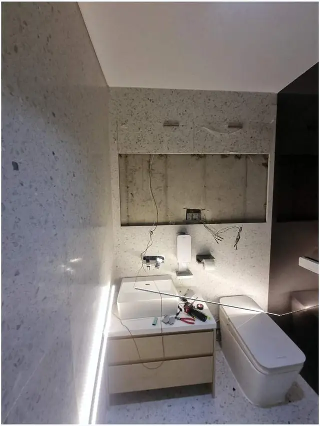
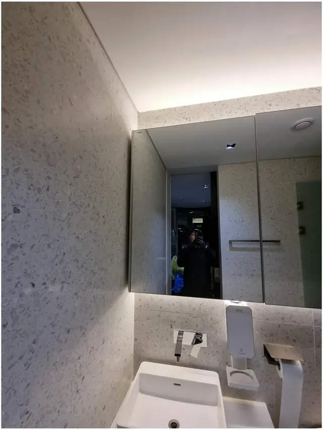

## 한 줄로 정리하면

- 거울장 **문이 처지거나, 경첩·모서리에 녹이 번지고, 거울 뒷면이 까맣게 번지면** 교체할 때예요.
- 새 거울장은 **기존 것과 가로·세로가 같거나 조금 더 큰 것**을 고르면 뗀 자국이 덜 보여요.
- 타일 벽이어도 **벽 재질에 맞는 방식으로** 단단히 고정하면 흔들림 없이 달 수 있어요.
- 뗀 자리 **쓰지 않는 나사 구멍**은 메우고 실리콘까지 정리해야 깔끔해요.

## 거울장, 언제 바꿔야 하나요?

욕실은 늘 습기가 차는 곳이라 거울장이 다른 가구보다 빨리 낡아요. 이런 모습이 보이면 고쳐 쓰기보다 바꾸는 쪽이 나아요.

1. **문이 비뚤게 닫히거나** 경첩을 조여도 금방 다시 처져요.
2. 문 모서리나 **경첩 주변에 녹**이 번져 수건이나 손에 묻어나요.
3. 거울 가장자리부터 **검게 얼룩이 번져** 얼굴이 잘 안 보여요.
4. 안쪽 선반이 **물에 불어 부풀거나** 칸이 모자라 세면대 위가 늘 어수선해요.

경첩 하나만 헐거운 거라면 경첩 교체로도 되지만, 녹과 거울 얼룩이 같이 보이면 전체 교체가 깔끔해요.

## 새 거울장은 어떻게 골라요?

- **크기**: 지금 거울장의 가로·세로·깊이를 줄자로 재요. 새 제품이 더 작으면 뒤쪽 벽에 **예전 자국이 드러날** 수 있어요.
- **깊이**: 세면대 수전과 부딪히지 않는지, 문을 열 때 머리에 걸리지 않는지 봐요.
- **수납**: 칫솔·화장품을 많이 두는 집은 **칸이 여러 개인 장**이나 양쪽으로 여는 장이 편해요.
- **콘센트·조명**: 조명이 붙은 거울장이나 안에 콘센트를 쓰는 제품이라면 **벽에 전기가 있는지** 먼저 확인해요.

제품은 직접 사셔도 되고, 자리 사진을 보내 주시면 맞을 만한 크기를 말씀드릴 수 있어요.

## 교체는 이렇게 진행해요

기존 거울장 상태와 새 제품 크기를 먼저 확인해요. 그다음 **타일이 상하지 않게** 기존 장을 떼고, 남은 나사와 실리콘을 정리해요. 새 장은 **수평을 맞춰** 벽 재질에 맞게 고정하고, 쓰지 않는 구멍은 메워요. 실제로 [서대문구 화장실 거울장 교체 사례](/cases/bath-224379248848/)도 이 순서로 작업했어요.

## 한눈에 비교

| 상태 | 이렇게 해요 |
| --- | --- |
| 경첩 하나만 헐거움 | 경첩 조정·교체 |
| 문 처짐 + 녹 + 거울 얼룩 | 거울장 전체 교체 |
| 수납이 부족함 | 칸 많은 장으로 크기 맞춰 교체 |
| 뗀 자리 구멍이 많음 | 구멍 메움 후 새 장 설치 |

## 사진 보내실 때 준비할 것

1. 지금 거울장 **정면** 한 장 (세면대까지 보이게)
2. 녹이나 얼룩이 있는 곳 **가까이서** 한 장
3. 거울장 **가로·세로** 대략 크기
4. 새 제품을 이미 사셨다면 **제품 이름이나 크기**

## 자주 묻는 질문

### 기존 거울장 철거도 해 주시나요?
네. 기존 장을 떼고 나사 구멍을 정리한 뒤 새 거울장을 달아요.

### 타일 벽에 구멍을 새로 뚫어도 괜찮나요?
타일 재질에 맞는 방식으로 뚫고 고정해요. 기존 구멍 자리를 쓸 수 있으면 최대한 활용해요. 남는 구멍은 [벽 구멍 복원](/repair/wall-hole/)처럼 메워 정리해요.

### 세면대 아래 장도 같이 바꿀 수 있나요?
네. 물에 불어 망가진 하부 장도 함께 볼 수 있어요. [욕실장 교체](/k/bathroom-cabinet/) 페이지에서도 확인할 수 있어요.

### 견적은 어떻게 받나요?
거울장 사진 1~2장과 동네를 문자(010-3051-8015)로 보내 주시면 예상 금액을 먼저 알려드려요. 서울 전 구, 경기 전 시·군, 전국 출장 가요.
