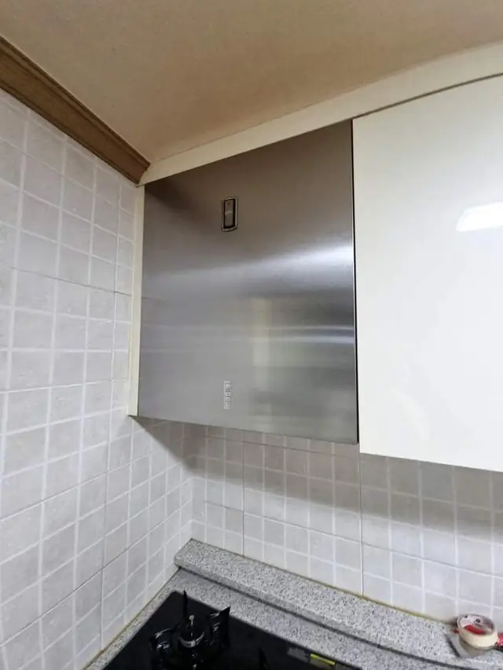
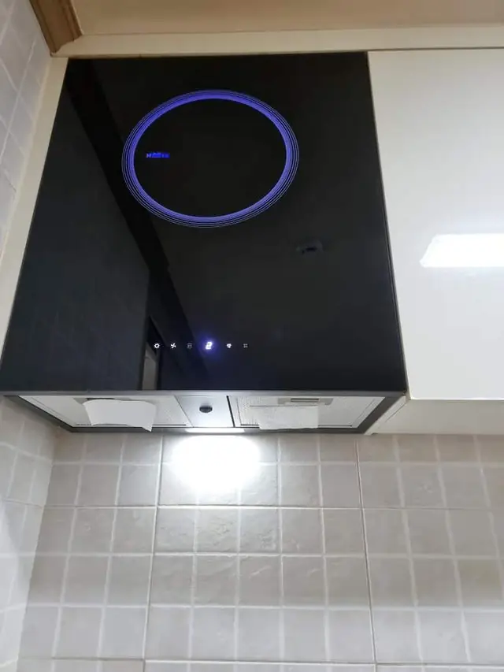

## 한 줄로 정리하면

- 후드 흡입이 약하면 먼저 **필터 기름때**를 봐요. 필터만 막혀도 연기를 거의 못 빨아들여요.
- 필터를 닦아도 약하면 **덕트(배기관)가 빠졌거나 꺾였는지**, 그다음 **모터**를 의심해요.
- 모터 소리가 거칠고 진동이 크거나, 몸통 안쪽까지 기름이 배었으면 **교체**가 나은 경우가 많아요.
- 교체할 때는 **상부장 사이 폭과 덕트 위치**만 맞으면 같은 자리에 새 후드를 달 수 있어요.

## 필터만 닦아도 될까요?

후드 아래쪽 금속 필터를 빼서 불빛에 비춰 보세요. **구멍 사이가 기름으로 막혀 빛이 잘 안 보이면** 흡입이 약한 가장 흔한 이유예요.

- 주방세제를 푼 따뜻한 물에 담갔다가 솔로 닦으면 대부분 다시 뚫려요.
- 필터가 휘었거나 테두리가 벌어져 틈으로 바람이 새면 필터만 새로 맞추는 게 나아요.
- 필터를 닦고 나서 흡입이 바로 좋아지면 후드 자체는 문제가 없는 거예요.

## 필터를 닦아도 약하면 어디를 보나요?

### 덕트(배기관)

후드 위 상부장 안이나 천장 쪽에 은색 주름관이 있어요. 이 관이 **후드에서 빠져 있거나, 중간이 눌리고 꺾여 있으면** 바람이 밖으로 못 나가요. 상부장 문을 열고 손으로 만져 봤을 때 관 이음매에서 바람이 새면 덕트 쪽 문제예요. 주름관이 오래돼 찢어졌으면 덕트를 같이 바꿔요.

### 모터

전원을 켰을 때 **덜덜거리는 소리나 쇠 긁히는 소리**가 나거나, 단수를 올려도 바람 세기가 비슷하면 모터가 약해진 거예요. 모터만 따로 구하기 어려운 오래된 제품이 많아서, 이때는 후드를 통째로 바꾸는 쪽을 권해 드려요.

## 교체가 맞는 경우는요?

- 모터 소음·진동이 크고 바람이 약할 때
- 몸통 안쪽까지 기름이 배어 **닦아도 끈적이고 냄새**가 날 때
- 버튼이 안 먹거나 조명이 자주 나갈 때
- 슬라이드 후드를 당겨도 잘 안 나오거나 레일이 걸릴 때

실제로 기름때가 심한 오래된 후드를 떼고, 기존 자리에 맞춰 통후드로 바꾼 [주방 통후드 교체 사례](/cases/kitchen-224381877174/)가 있어요.

## 새 후드 고를 때 맞춰 볼 것

1. **상부장 사이 폭**: 지금 후드 양옆 상부장 사이 길이를 재 두세요.
2. **후드 종류**: 상부장 아래 숨는 슬라이드 후드인지, 상부장 사이에 끼우는 통후드·허리케인 후드인지 봐요.
3. **덕트 나가는 위치**: 위로 나가는지, 뒤로 나가는지에 따라 맞는 제품이 달라요.
4. **전원**: 콘센트에 꽂는지, 전선을 직접 연결하는지 봐요.

## 한눈에 비교

| 증상 | 의심할 곳 | 이렇게 해요 |
| --- | --- | --- |
| 연기를 못 빨아들임, 소리는 보통 | 필터 기름때 | 필터 세척·교체 |
| 필터 닦아도 약함, 상부장 안에서 바람 샘 | 덕트 빠짐·꺾임 | 덕트 다시 연결·교체 |
| 덜덜거림, 단수 바꿔도 같음 | 모터 | 후드 교체 |
| 몸통 끈적임·냄새, 버튼 고장 | 후드 전체 노후 | 후드 교체 |

## 사진 보내실 때 준비할 것

1. 후드 **정면** 한 장 (양옆 상부장까지 보이게)
2. 필터를 뺀 **안쪽** 한 장
3. 상부장 문을 열어 **덕트가 보이게** 한 장
4. 새 제품을 사 두셨으면 **모델명**

## 자주 묻는 질문

### 새 후드 크기가 지금 것과 달라도 되나요?
상부장 폭과 덕트 위치를 보고 맞춰요. 상부장을 조금 손봐야 하면 미리 말씀드려요.

### 후드 사기 전에 맞는지 봐 주실 수 있나요?
네. 지금 후드 사진과 사려는 제품 모델명을 보내 주시면 규격이 맞는지 먼저 봐 드려요.

### 가스레인지도 같이 바꿀 수 있나요?
네. 후드와 빌트인 가스레인지를 같은 날 함께 바꾸는 경우가 많아요. [가스레인지·후드 교체](/repair/gas-range/)와 [주방 후드 교체](/k/kitchen-hood/) 페이지도 참고해 주세요.

### 견적은 어떻게 받나요?
후드 사진 1~2장과 동네를 문자(010-3051-8015)로 보내 주시면 예상 금액을 먼저 알려드려요. 서울 전 구, 경기 전 시·군, 전국 출장 가요.
