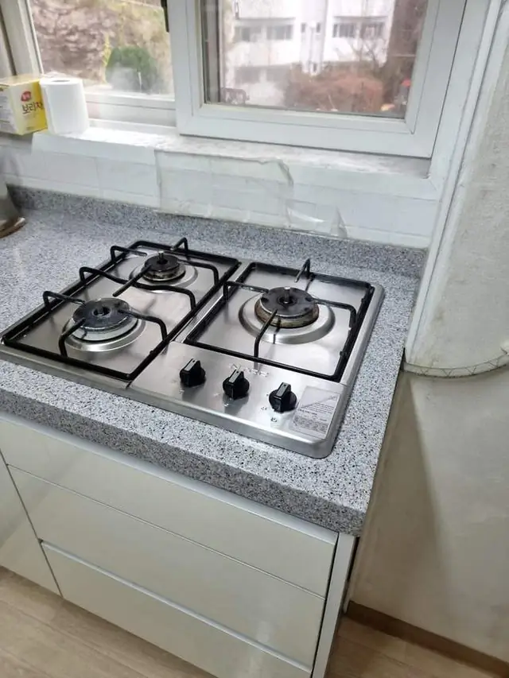
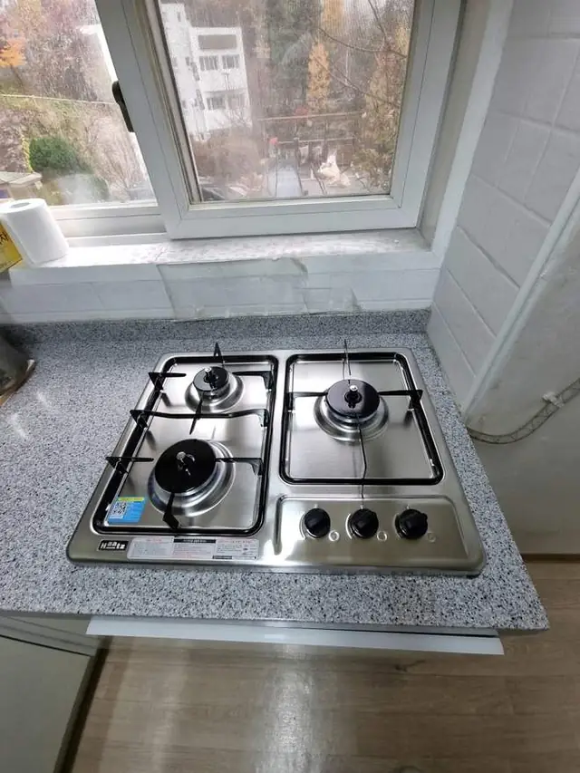

## 한 줄로 정리하면

- 빌트인 가스레인지는 **겉 크기가 아니라 상판에 뚫린 구멍(타공) 크기**를 맞춰야 해요.
- 새 제품 설명서의 **타공 치수**와 지금 상판 구멍을 비교하면 그대로 들어가는지 알 수 있어요.
- 구멍이 **작으면 상판을 더 자르고**, **크면 틈을 메우거나 받침을 대서** 맞춰요.
- 사기 전에 지금 레인지 사진과 사려는 모델명을 보내 주시면 맞는지 먼저 봐 드려요.

## 겉 크기와 구멍 크기는 왜 다른가요?

빌트인 가스레인지는 윗판(유리나 스테인리스)이 상판 위에 걸치고, 아래 몸통만 구멍 속으로 들어가요. 그래서 **겉 크기가 비슷해도 몸통 크기가 다르면** 구멍에 안 들어가거나, 반대로 헐렁해서 틈이 보여요. 제조사마다, 같은 회사라도 모델마다 타공 치수가 달라요.

## 지금 구멍 크기는 어떻게 재나요?

1. 레인지를 빼지 않아도 돼요. **하부장 문을 열고** 아래에서 몸통이 들어간 구멍 가로·세로를 재요.
2. 아래에서 재기 어려우면 레인지 **모델명 스티커**(옆면이나 아래)를 찍어 두세요. 모델명으로 예전 타공 치수를 찾을 수 있어요.
3. 새 제품 설명서나 판매 페이지에서 **"타공 치수" 또는 "설치 치수"**를 찾아 비교해요.

## 구멍이 안 맞으면 어떻게 하나요?

### 새 제품 구멍이 더 클 때

상판을 **필요한 만큼만 더 잘라** 넓혀요. 인조대리석·대리석 상판은 먼지와 깨짐을 줄이며 잘라야 해서 상판 재질을 먼저 확인해요. 상판 절단은 [대리석 상판 절단·인덕션 매립](/repair/induction-cut/) 작업과 같은 방식이에요.

### 새 제품 구멍이 더 작을 때

남는 틈을 **메우거나 받침을 대서** 새 제품이 흔들리지 않게 고정해요. 틈이 크면 상판 구멍을 메우는 작업을 먼저 해요. [가스레인지 구멍 메우기](/k/gas-range-hole-fill/) 페이지도 참고해 주세요.

### 2구에서 3구로, 또는 반대로 바꿀 때

구수가 바뀌면 폭이 크게 달라져서 대부분 상판을 자르거나 메워야 해요. [가스레인지 크기 바꾸기](/k/gas-range-resize/) 페이지에 자세히 있어요.

## 인덕션으로 바꿔도 같은가요?

인덕션도 타공 치수를 맞추는 건 같아요. 다만 **전기 용량과 콘센트**가 따로 필요하고, 가스 배관은 막아야 해요. 가스레인지 자리를 넓혀 인덕션을 넣은 [강남구 인덕션 매립 자리 만들기 사례](/cases/kitchen-224359030070/)가 있어요.

## 한눈에 비교

| 상황 | 하는 작업 | 확인할 것 |
| --- | --- | --- |
| 타공 치수가 같음 | 빼고 그대로 넣기 | 가스 연결·점화 |
| 새 제품 구멍이 큼 | 상판 추가 절단 | 상판 재질 |
| 새 제품 구멍이 작음 | 틈 메우기·받침 | 흔들림 없는 고정 |
| 2구 ↔ 3구 | 절단 또는 메우기 | 하부장 폭 |
| 인덕션으로 변경 | 상판 가공 + 전기 | 전기 용량·콘센트 |

## 사진 보내실 때 준비할 것

1. 지금 가스레인지 **위에서** 한 장
2. **모델명 스티커** 한 장 (찾기 어려우면 빼셔도 돼요)
3. 하부장 문을 열어 **아래쪽 몸통**이 보이게 한 장
4. 사려는 새 제품 **모델명**

## 자주 묻는 질문

### 제품은 제가 사야 하나요?
네, 사 두신 제품으로 설치해요. 사기 전에 사진을 보내 주시면 규격이 맞는지 먼저 봐 드려요.

### 불이 잘 안 붙는데 꼭 바꿔야 하나요?
점화가 약하고 불꽃이 고르지 않은 오래된 제품은 바꾸는 쪽을 많이 해요. 오래된 2구 레인지를 바꾼 [2구 가스레인지 교체 사례](/cases/kitchen-224416766430/)도 있어요.

### 후드도 같이 바꿀 수 있나요?
네. 같은 날 후드까지 함께 바꿀 수 있어요. [가스레인지·후드 교체](/repair/gas-range/) 페이지를 참고해 주세요.

### 견적은 어떻게 받나요?
가스레인지 사진 1~2장과 동네를 문자(010-3051-8015)로 보내 주시면 예상 금액을 먼저 알려드려요. 서울 전 구, 경기 전 시·군, 전국 출장 가요.
