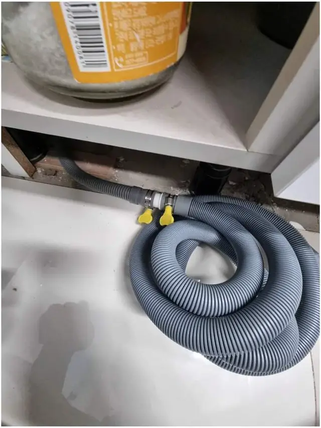
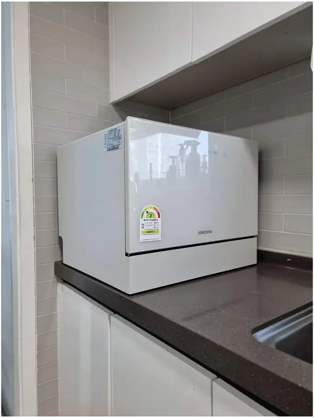

## 한 줄로 정리하면

- 쓰던 식기세척기는 **새 집에서도 다시 설치할 수 있어요.** 전 집에서 떼는 일과 새 집에 넣는 일을 한 번에 맡기면 편해요.
- 가장 먼저 볼 건 새 집 싱크대에 **들어갈 자리**와 **급수·배수를 연결할 곳**이 있는지예요.
- 자리가 없으면 **하부장을 고쳐서** 넣거나, 6인용이라면 **상판 위에** 두는 방법도 있어요.
- 전 집은 식기세척기를 뺀 자리를 **비워 둘지, 채워 둘지** 미리 정해 두세요. 세입자라면 원상복구가 필요할 수 있어요.

## 이삿짐센터가 그냥 옮겨 주면 안 되나요?

이삿짐센터는 보통 제품을 **들어서 옮기는 일**까지만 해요. 식기세척기는 수도(급수)와 하수(배수), 전원이 싱크대 안에 연결돼 있어서, 떼기 전에 물을 잠그고 호스를 정리해야 하고 새 집에서는 그 연결을 다시 해야 합니다. 빌트인 제품이라면 하부장 안에 나사로 고정돼 있어 몸체를 빼는 것부터 일이에요. 그래서 이사 날짜에 맞춰 **철거와 설치를 따로 잡는** 분이 많아요.

## 떼기 전에 전 집에서 할 일

1. 마지막 세척이 끝나면 하루쯤 **문을 열어 안을 말려요.** 남은 물이 이동 중에 새어 나올 수 있어요.
2. 싱크대 아래 **식기세척기용 밸브를 잠가요.** 어디 있는지 모르면 사진만 찍어 두셔도 돼요.
3. 설명서와 **설치 부품(고정 브래킷, 호스 연결구)**은 버리지 말고 같이 챙겨요. 새 집에서 다시 써요.
4. 빼고 난 자리를 어떻게 할지 정해요. 빈칸으로 둘지, [하부장을 다시 채울지](/repair/dishwasher-removal/) 정해 두면 하루에 끝낼 수 있어요.

## 새 집에 자리가 있는지 어떻게 보나요?

새 집 싱크대를 보면서 아래 세 가지를 확인하면 돼요.

- **폭과 높이:** 빌트인 제품은 하부장 한 칸을 비워야 해요. 지금 쓰는 제품의 모델명을 알려 주시면 필요한 폭과 높이를 맞춰 볼 수 있어요.
- **물 연결:** 싱크대 아래 수도 배관에서 물을 나눠 받을 수 있는지, 배수를 연결할 자리가 있는지 봐요.
- **전원:** 싱크대 근처에 콘센트가 있는지 봐요. 멀티탭을 길게 끌어 쓰는 건 피하는 게 좋아요.

## 자리가 없으면 어떻게 하나요?

새 집에 식기세척기 칸이 없는 경우가 제일 많아요. 이럴 때는 방법이 두 가지예요.

**하부장을 고쳐서 넣기:** 싱크대 하부장 한 칸의 문과 선반을 떼고, 제품 크기에 맞게 옆판과 바닥을 손봐서 빌트인처럼 넣어요. [양천구 식기세척기 하부장 빌트인 사례](/cases/kitchen-224369216537/)처럼 기존 싱크대를 그대로 두고 자리만 만드는 방식이에요.

**상판 위에 두기:** 6인용처럼 작은 제품은 하부장을 건드리지 않고 상판 위에 올려 급수·배수만 연결할 수 있어요. 호스는 싱크대 안으로 숨겨 정리해요.

## 한눈에 비교

| 새 집 상황 | 방법 | 확인할 것 |
| --- | --- | --- |
| 식기세척기 칸이 이미 있음 | 그 자리에 다시 설치 | 칸 폭·높이, 문짝 연결 방식 |
| 칸이 없음, 하부장 고쳐도 됨 | 하부장 한 칸 리폼 후 빌트인 | 그 칸에 배관이 지나가는지 |
| 칸이 없음, 장을 건드리기 싫음 | 상판 위에 설치(소형) | 상판 여유 공간, 호스 길이 |
| 브랜드가 바뀐 칸 | 문짝·고정 방식 맞춰 조정 | 삼성·LG 등 제품 규격 |

브랜드에 따라 문짝 다는 방식이나 고정 위치가 조금씩 달라요. [삼성 식기세척기](/k/samsung-dishwasher/), [LG 식기세척기](/k/lg-dishwasher/) 설치 페이지도 참고해 보세요.

## 견적 받을 때 준비할 것

- 식기세척기 **모델명** (본체 옆이나 문 안쪽 스티커)
- 전 집 싱크대와 **새 집 싱크대 사진** 각 1~2장 (싱크대 아래 문을 열고 찍은 사진이 있으면 좋아요)
- 두 집의 **동네**와 이사 날짜
- 전 집 빈자리를 **채울지 비워 둘지**

## 자주 묻는 질문

### 철거와 설치를 같은 날 할 수 있나요?
두 집 거리와 일정에 따라 달라요. 이사 날짜와 두 집 동네를 알려 주시면 하루에 할지, 나눠서 할지 맞춰 드려요.

### 빌트인으로 쓰던 걸 새 집에서는 상판 위에 둘 수 있나요?
빌트인 전용 제품은 상판 위에 두기 어려운 경우가 많아요. 모델명을 보고 어떤 방식이 맞는지 먼저 알려드려요.

### 전 집에 빈자리가 남으면 어떻게 하나요?
선반이나 문을 다시 달아 수납장으로 쓰게 만들 수 있어요. 세입자라 원래대로 돌려놔야 하면 그것도 함께 해요.

### 견적은 어떻게 받나요?
두 집 싱크대 사진과 동네를 문자(010-3051-8015)로 보내 주시면 방법과 예상 금액을 먼저 알려드려요. 서울 전 구, 경기 전 시·군, 그 밖의 지역도 출장 가요. 자세한 작업은 [식기세척기 이전 설치](/k/dishwasher-move/) 페이지에서 볼 수 있어요.
