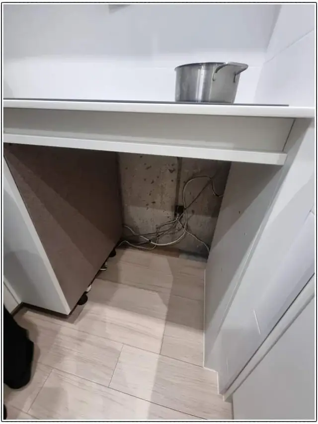
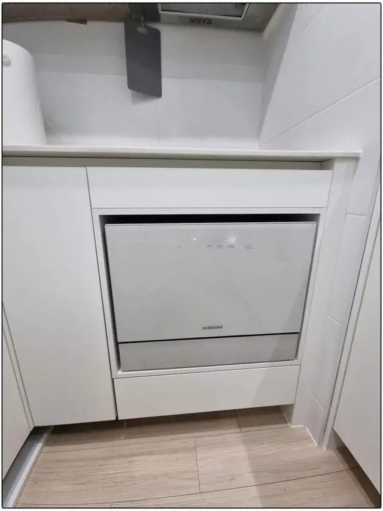

## 한 줄로 정리하면

- 설치가 쉬운지 어려운지는 **브랜드보다 설치 방식**(빌트인·프리스탠딩·상판형)과 **크기**(6인용·12인용)가 정해요.
- 같은 브랜드라도 **모델마다 필요한 폭·높이·깊이가 달라요.** 제품 설치 설명서의 치수를 꼭 먼저 확인하세요.
- 제조사 설치는 **자리가 이미 준비된 상태**를 기준으로 해요. 하부장을 빼거나 상판을 손봐야 하면 **미리 자리를 만들어 두는** 게 좋아요.
- 모델명과 주방 사진만 있으면 **들어갈 수 있는지 먼저** 확인해 드려요.

## 삼성이냐 LG냐보다 먼저 볼 것

식기세척기를 고를 때 브랜드부터 고민하시는데, 설치 쪽에서 보면 아래 세 가지가 훨씬 중요해요.

1. **설치 방식**: 하부장 안에 넣는 빌트인인지, 따로 세우는 프리스탠딩인지, 상판 위에 올리는 6인용 상판형인지
2. **크기**: 6인용과 12인용은 폭과 높이가 달라서, 들어갈 칸 크기가 달라져요.
3. **문 열림 공간**: 문이 앞으로 완전히 열려야 그릇을 넣고 빼요. 맞은편 가구나 식탁과 부딪히지 않는지 봐야 해요.

이 세 가지가 맞으면 브랜드는 취향과 기능으로 고르셔도 돼요.

## 같은 브랜드인데 왜 자리가 안 맞을까요?

같은 회사 제품이라도 **연식과 모델**에 따라 크기가 조금씩 달라요. 예전 제품을 빼고 새 제품을 넣을 때, 몇 센티 차이로 안 들어가는 일이 생기는 이유예요. 그래서 "삼성이니까 그 자리에 맞겠지"보다는 **새 제품 설치 설명서의 치수와 실제 칸 크기**를 비교하는 게 정확해요.

위 사진은 하부장을 제품 크기에 맞게 리폼해서 6인용 식기세척기를 빌트인으로 넣은 현장이에요. 자세한 순서는 [하부장 빌트인 사례](/cases/kitchen-224369216537/)에 있어요.

## 제조사 설치 기사님이 "자리가 안 돼요" 할 때

이런 경우가 많아요.

- 하부장 **서랍장이나 문짝을 떼야** 하는데 그 작업은 설치 범위가 아닐 때
- 칸 폭이 조금 좁아 **옆판이나 상판을 손봐야** 할 때
- **급수·배수·전원**이 멀어서 새로 끌어와야 할 때

이럴 때 설치 날짜 전에 자리를 먼저 만들어 두면, 제품이 오는 날 바로 설치가 끝나요. 자리 만들기부터 급수·배수 연결까지 한 번에 맡기셔도 돼요.

## 한눈에 비교

| 설치 방식 | 이런 집에 맞아요 | 미리 확인할 것 |
| --- | --- | --- |
| 빌트인 | 하부장 한 칸을 비울 수 있는 집 | 칸 폭·높이, 서랍장 철거 여부 |
| 프리스탠딩 | 하부장을 건드리기 싫은 집 | 놓을 자리, 배수 거리 |
| 6인용 상판형 | 1~2인 가구, 좁은 주방 | 상판 위 공간, 급수·배수 위치 |

## 준비할 것

1. 사려는(또는 산) 제품의 **모델명**
2. 넣을 자리 **정면 사진**과 **싱크대 아래 배관 사진**
3. 넣을 칸의 **폭·높이·깊이**(재 보실 수 있으면)
4. 제조사 **설치 예정일**이 정해졌다면 그 날짜

## 자주 묻는 질문

### 브랜드별로 따로 해 주시나요?
네. 삼성, LG 모두 설치해요. 브랜드별 작업은 [삼성 식기세척기 설치](/k/samsung-dishwasher/), [LG 식기세척기 설치](/k/lg-dishwasher/) 페이지에서 볼 수 있어요.

### 상판형 6인용은 어떻게 연결하나요?
싱크대 아래에서 급수와 배수를 연결하고 호스를 깔끔하게 정리해요. [6인용 식기세척기](/k/dishwasher-6person/) 페이지와 [급수·배수 연결 사례](/cases/kitchen-224343957645/)를 참고하세요.

### 쓰던 식기세척기를 빼고 새 걸 넣을 수 있나요?
네. 기존 제품 철거 후 새 제품 크기에 맞게 자리를 다시 맞춰요. 빼기만 하실 거면 [식기세척기 철거](/repair/dishwasher-removal/)도 있어요.

### 견적은 어떻게 받나요?
모델명과 넣을 자리 사진 1~2장, 동네를 문자(010-3051-8015)로 보내 주시면 들어갈 수 있는지와 예상 금액을 먼저 알려드려요. 서울 전 구, 경기 전 시·군은 물론 다른 지역도 일정을 맞춰 출장 가요.
