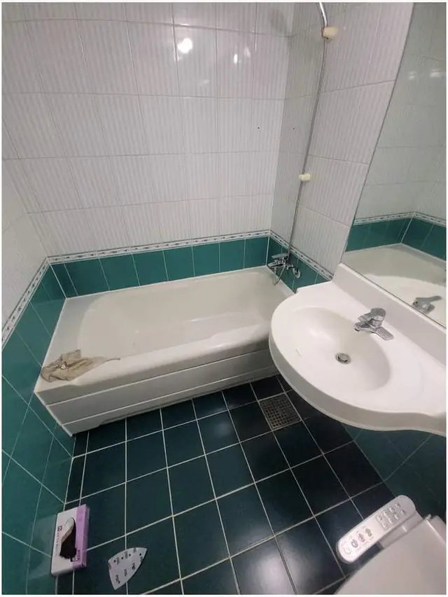
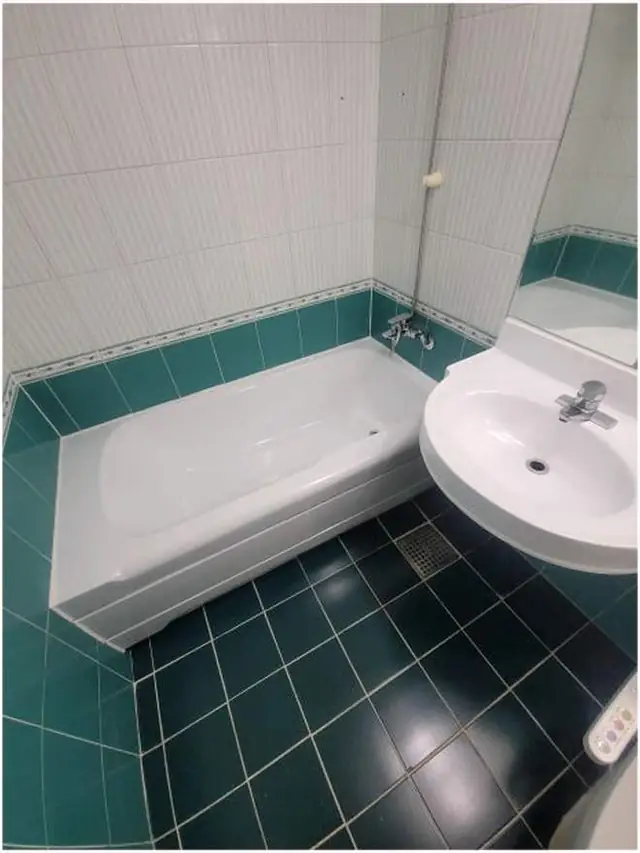

## 한 줄로 정리하면

- 욕실은 **수전·팝업·실리콘·줄눈·문·거울장·환풍기·욕조 표면**처럼 고장 난 곳만 따로 고칠 수 있어요.
- 타일을 다 뜯지 않아도 되는 일이라면 대부분 **부분 수리**로 해결돼요.
- 다만 **아래층으로 물이 새거나, 타일이 넓게 들뜨고 깨졌으면** 방수부터 봐야 해서 큰 공사를 생각해야 해요.
- 여러 곳이 불편하면 **한 번에 사진을 모아** 보내 주시면 같은 날 같이 봐 드려요.

## 부분 수리로 되는 곳은 어디인가요?

| 불편한 곳 | 부분 수리 | 관련 글·페이지 |
| --- | --- | --- |
| 세면대 물이 안 내려감 | 팝업·배수관 교체 | [세면대 팝업 교체](/repair/sink-popup/) |
| 수전에서 물이 샘 | 수전 교체 | [수전 교체](/repair/faucet/) |
| 실리콘 곰팡이 | 실리콘 재시공 | [욕실 실리콘 재시공](/k/bathroom-silicone/) |
| 줄눈 까매짐·빠짐 | 줄눈 부분 보수 | [타일 줄눈](/k/tile-grout/) |
| 문이 처져 안 닫힘 | 경첩 교체·보강 | [화장실 문 수리](/repair/door-hinge/) |
| 욕조 기스·얼룩 | 욕조 코팅 | [욕조 수리](/repair/bathtub-repair/) |
| 환풍기 소리·냄새 | 환풍기 교체 | [화장실 환풍기 교체](/k/bathroom-fan/) |
| 벽 구멍(부스·선반 뗀 자리) | 구멍 메우기 | [벽 구멍 메우기](/repair/wall-hole/) |

이 일들은 대부분 **타일을 깨지 않고** 해요. 그래서 욕실을 며칠씩 못 쓰는 일이 적고, 실리콘·코팅처럼 마르는 시간이 필요한 작업은 미리 말씀드려요.

## 부분 수리로는 부족한 경우는요?

- **아래층 천장에 물자국**이 생겼다는 연락을 받았을 때
- 타일을 두드리면 **넓은 범위가 텅텅 울리고 들떠** 있을 때
- 바닥 물이 **배수구 쪽으로 안 흐르고 한쪽에 고일** 때
- 욕조에 **금이 가서 물이 새거나**, 바닥이 꺼질 때

이럴 때는 겉만 고쳐도 다시 생길 수 있어서, 원인을 먼저 보고 어디까지 해야 할지 솔직하게 말씀드려요.

## 여러 곳을 같이 맡기면 순서는요?

같은 날 여러 작업을 하면 순서를 이렇게 잡아요.

1. **떼고 메우는 작업** 먼저: 낡은 거울장·선반·부스를 떼고 벽 구멍을 메워요.
2. **배관·기구 교체**: 수전, 팝업, 환풍기를 바꿔요.
3. **줄눈·실리콘**은 마지막에: 다른 작업이 끝난 뒤에 해야 다시 손대지 않아요.

실리콘을 먼저 쏘고 수전을 나중에 바꾸면 수전 주변 실리콘을 다시 해야 해서, 마감 작업은 꼭 끝에 해요.

## 한눈에 비교

| | 부분 수리 | 큰 공사를 생각할 때 |
| --- | --- | --- |
| 이런 증상 | 기구 고장, 곰팡이, 기스, 문 처짐 | 아래층 누수, 타일 넓게 들뜸 |
| 타일 | 그대로 둬요 | 뜯고 방수부터 봐요 |
| 욕실 못 쓰는 시간 | 대부분 하루 안 | 며칠 걸릴 수 있어요 |
| 먼저 할 일 | 불편한 곳 사진 | 새는 곳·원인 확인 |

## 사진 보내실 때 준비할 것

1. 욕실 **문 앞에서 전체** 한 장
2. 불편한 곳마다 **가까이서** 한 장씩
3. 물이 샌다면 **언제** 새는지 (물 쓸 때만, 늘)
4. 사 두신 제품(수전·거울장 등)이 있으면 **모델명**

## 자주 묻는 질문

### 경첩 하나 같은 작은 수리도 불러도 되나요?
네. 경첩, 손잡이, 팝업 하나 같은 작은 작업도 많이 해요. 처진 문을 바로잡은 [화장실 문 경첩 교체 사례](/cases/door-224424459908/)도 있어요.

### 하루 만에 끝나나요?
대부분 하루 안에 끝나요. 실리콘이나 코팅처럼 마르는 시간이 필요한 작업은 쓰지 말아야 할 시간을 미리 알려 드려요.

### 욕실 말고 다른 곳도 같이 봐 주시나요?
네. 주방 수전, 방문, 붙박이장처럼 집 안 다른 곳도 같은 날 함께 볼 수 있어요. [욕실 부분 수리](/k/bathroom-partial/) 페이지도 참고해 주세요.

### 견적은 어떻게 받나요?
욕실 사진 몇 장과 동네를 문자(010-3051-8015)로 보내 주시면 예상 금액을 먼저 알려드려요. 서울 전 구, 경기 전 시·군, 전국 출장 가요.
