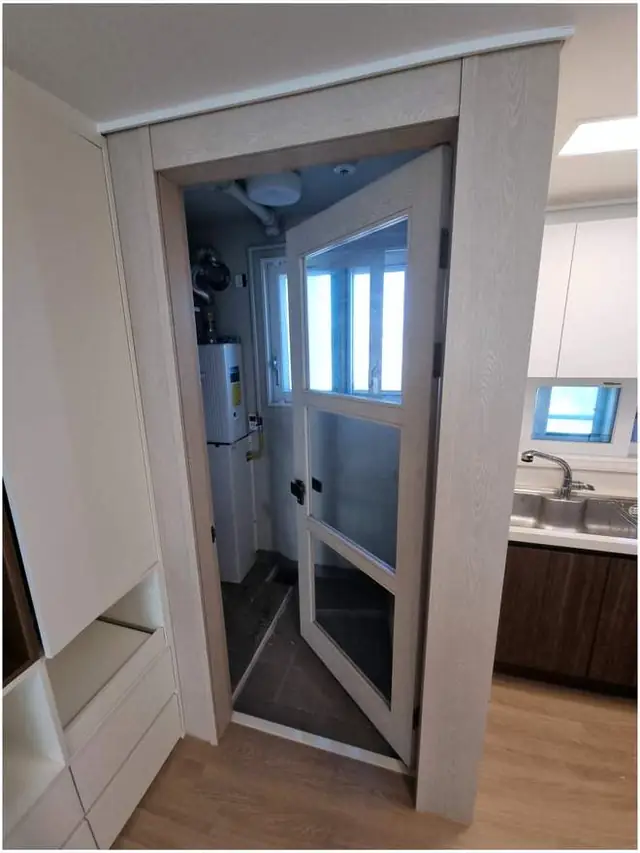
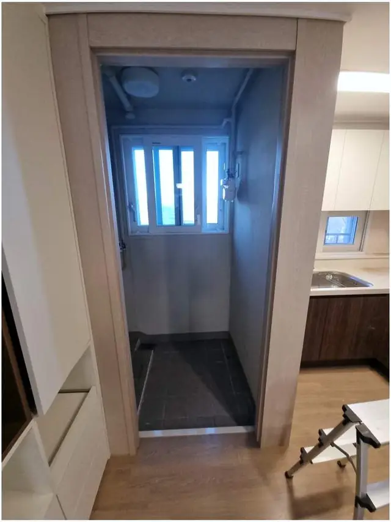

## 한 줄로 정리하면

- 대부분 **쓰던 문을 그대로** 반대쪽으로 다시 달아서 방향을 바꿔요. 문을 새로 살 일은 드물어요.
- 경첩 자리를 옮기고 **손잡이·도어락 방향**도 함께 맞춰요.
- 예전 경첩 홈은 **메우고 색을 맞춰** 마감해서 티가 덜 나게 해요.
- 문 하나는 보통 **방문한 날** 끝나요. 문틀 상태가 나쁘면 미리 말씀드려요.

## 문 방향을 바꾸면 뭐가 좋아지나요?

안쪽으로 열리는 문은 문짝이 지나가는 반원만큼 공간을 못 써요. 좁은 세탁실이라면 문이 **세탁기·건조기 앞을 막아** 문을 닫아야 세탁기 문을 열 수 있고, 작은 방은 문 뒤에 가구를 못 둬요. 방향만 바꿔도 그 반원이 통째로 생겨서 **동선이 편해지고 수납 자리가 늘어요.**

## 어떤 방향으로 바꿀 수 있나요?

문 방향은 두 가지로 나눠 생각하면 쉬워요.

- **안 ↔ 밖:** 안으로 열리던 문을 바깥쪽으로 열리게 바꿔요. 좁은 세탁실·다용도실·화장실에서 가장 많이 찾으세요.
- **왼쪽 ↔ 오른쪽:** 경첩을 반대편 기둥으로 옮겨 손잡이 쪽을 바꿔요. 스위치 위치나 동선 때문에 바꾸는 경우가 많아요.

밖으로 열리게 바꿀 때는 문이 열렸을 때 **복도·현관 동선을 막지 않는지**, 바깥 벽의 스위치나 가구에 부딪히지 않는지 먼저 봐요.

## 바꾸기 전에 집에서 확인해 보세요

1. 문이 열리는 쪽 **바닥에 턱이나 매트**가 있는지 (문 아래가 걸릴 수 있어요)
2. 문이 새로 열릴 쪽 벽에 **스위치·콘센트·액자**가 있는지
3. 손잡이가 **잠금형**인지, **도어락**이 달려 있는지
4. 문틀에 **들뜸·깨짐·물 먹은 자국**이 있는지 (특히 욕실·세탁실 문)

문틀이 상했으면 방향을 바꾸면서 그 부분 보수를 같이 하는 게 좋아요. 처진 문이라면 [방문이 안 닫힐 때](/k/door-not-closing/) 페이지도 참고해 보세요.

## 작업은 이렇게 해요

1. 문짝을 떼고 **문틀·문짝 구조**를 확인해요.
2. 반대쪽에 **경첩 홈을 새로 파고** 손잡이 자리를 맞춰요.
3. 문을 다시 달고 **수평과 틈**을 맞춰 부드럽게 닫히게 해요.
4. 예전 경첩 홈과 손잡이 받이 자리를 **메우고 마감**해요.

실제 작업은 [세탁실 문 방향 변경 사례](/cases/door-224357244224/)에서 전·후 사진으로 볼 수 있어요.

## 한눈에 비교

| 경우 | 하는 작업 | 확인할 것 |
| --- | --- | --- |
| 안쪽 → 바깥쪽 | 경첩·문 멈춤 위치 바꿈 | 바깥 동선, 벽 스위치 |
| 왼쪽 → 오른쪽 | 경첩을 반대 기둥으로 옮김 | 손잡이 방향, 스위치 위치 |
| 도어락 달린 문 | 도어락 방향까지 함께 맞춤 | 도어락 모델 사진 |
| 문틀이 상한 문 | 방향 변경 + 문틀 보수 | 들뜸·물 먹은 자국 |
| 예전 홈이 신경 쓰일 때 | 메움 + 색 맞춤, 필요하면 필름 | 문틀 색·재질 |

## 사진 찍을 때 이렇게 찍어 주세요

- 문을 **닫은 상태**로 문 전체 한 장
- 문을 **활짝 연 상태**로 걸리는 곳이 보이게 한 장
- **경첩**과 **손잡이(또는 도어락)** 가까이 한 장씩
- 어느 쪽으로 열리게 바꾸고 싶은지 한 줄 적어 주시면 돼요

## 자주 묻는 질문

### 문을 새로 사야 하나요?
대부분은 쓰던 문을 그대로 반대로 달아요. 문짝이 뒤틀렸거나 아래가 물에 불어 상했을 때만 교체를 말씀드려요.

### 예전 경첩 자리는 티 나지 않나요?
홈을 메우고 문틀 색과 비슷하게 맞춰 마무리해요. 더 깔끔하게 하고 싶으면 [문틀 필름](/k/door-film/)으로 덮는 방법도 있어요.

### 화장실 문도 바꿀 수 있나요?
네. 욕실 문은 문틀 아래가 물에 약해서 상태를 같이 보고, 필요하면 그 부분 보수도 함께 해요.

### 견적은 어떻게 받나요?
문 사진과 동네를 문자(010-3051-8015)로 보내 주시면 바꿀 수 있는지와 예상 금액을 먼저 알려드려요. 서울 전 구, 경기 전 시·군, 그 밖의 지역도 출장 가요. 자세한 내용은 [문 방향 바꾸기](/repair/door-direction/) 페이지에서 볼 수 있어요.
