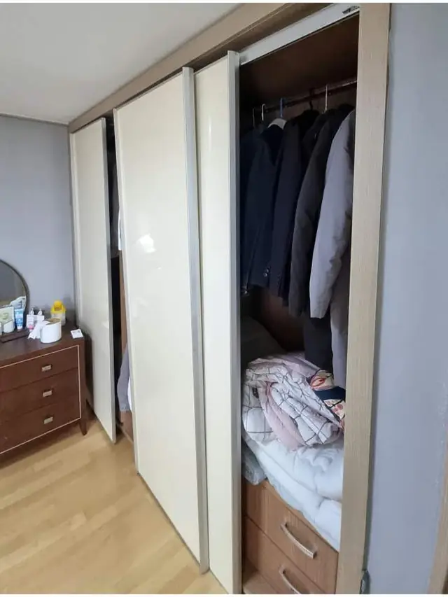
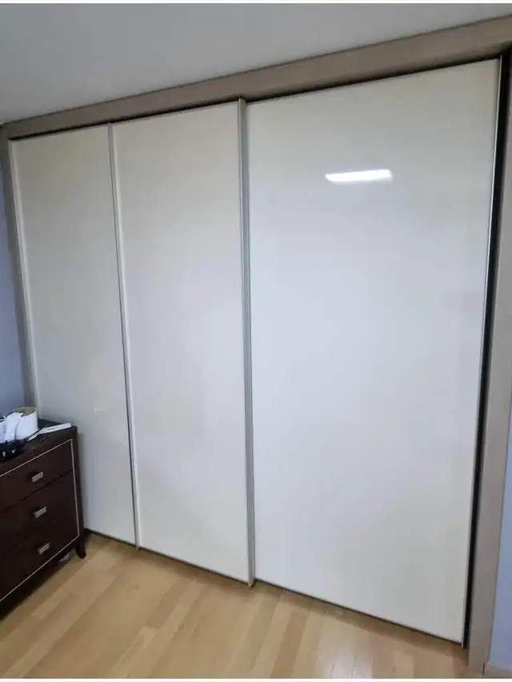

## 한 줄로 정리하면

- 슬라이드 붙박이장 문이 **무겁고 덜컹거리는 건 대부분 롤러가 닳거나 깨진 것**이에요. 옷장을 바꿀 필요는 거의 없어요.
- 문이 **레일에서 빠지거나** 두 짝이 **같이 끌려가면** 롤러 높이나 레일 상태를 같이 봐요.
- 레일이 **휘었으면** 롤러와 함께 바꾸는 게 오래 가요.
- 깨진 롤러를 그대로 쓰면 **문짝 아래나 레일까지** 상할 수 있어요.

## 왜 롤러가 먼저 망가지나요?

슬라이드 문은 큰 문짝 무게를 **작은 바퀴 몇 개**가 받치고 있어요. 매일 여닫다 보면 바퀴가 닳아 납작해지거나, 플라스틱 바퀴가 **깨지고 갈라져요.** 거울이 붙은 문처럼 무거운 문짝일수록 더 빨리 상해요. 레일에 먼지·머리카락이 끼면 바퀴가 헛돌면서 마모가 더 빨라져요.

## 증상으로 알아보는 원인

- **밀 때 '드르륵' 소리와 함께 무겁다** → 롤러 바퀴가 닳거나 깨졌어요.
- **문이 한쪽으로 기울어 아래가 긁힌다** → 한쪽 롤러만 망가졌거나 높이가 틀어졌어요.
- **문이 레일에서 자꾸 빠진다** → 롤러가 깨졌거나 레일이 휘었어요.
- **한 짝을 밀면 다른 짝이 같이 끌려온다** → 롤러 높이가 안 맞아 두 문짝이 서로 닿고 있어요.

## 집에서 먼저 해 볼 수 있는 것

1. 바닥·위쪽 **레일의 먼지와 이물질**을 청소기로 빼 주세요.
2. 문을 끝까지 밀어 **어느 구간에서 걸리는지** 확인해요.
3. 문 아래 **틈 높이가 양쪽이 같은지** 봐요. 한쪽이 낮으면 그쪽 롤러가 문제예요.

청소만으로 좋아지지 않거나 바퀴 깨지는 소리가 나면 롤러를 바꿔야 해요. 문짝이 무거워 혼자 내리다 다칠 수 있으니 무리해서 떼지 않는 게 좋아요.

## 롤러 교체는 이렇게 해요

1. 문짝을 내려 **롤러와 레일 상태**를 확인해요.
2. **같은 규격 롤러**로 바꾸고, 레일을 정리해요.
3. 문 높이를 맞춰 **두 짝이 서로 닿지 않게** 조정해요.
4. 여러 번 여닫으며 **소리·걸림**이 없는지 확인해요.

실제 작업은 [붙박이장 문 수리 사례](/cases/door-224317293941/)에서 볼 수 있어요.

## 한눈에 비교

| 증상 | 원인 | 작업 |
| --- | --- | --- |
| 무겁고 드르륵 소리 | 롤러 마모·깨짐 | 롤러 교체 |
| 한쪽으로 기울어 긁힘 | 한쪽 롤러 파손·높이 틀어짐 | 롤러 교체 + 높이 조정 |
| 레일에서 빠짐 | 롤러 깨짐 또는 레일 휨 | 롤러 교체, 레일 휘면 레일도 |
| 두 짝이 같이 끌려옴 | 롤러 높이 차이 | 높이 조정, 필요하면 롤러 교체 |
| 문짝 아래가 깨짐 | 깨진 롤러로 오래 사용 | 롤러 교체 + 문짝 하부 보수 |

## 사진 찍을 때 이렇게 찍어 주세요

- 붙박이장 **문 전체**가 보이게 한 장
- 문 **아래쪽 롤러와 바닥 레일**을 가까이서 한 장
- **위쪽 레일**도 한 장 (위에 매달린 방식인지 보려고요)
- 문에 **거울**이 붙어 있으면 함께 알려 주세요

## 자주 묻는 질문

### 롤러 규격을 몰라도 되나요?
네. 문 사진과 롤러 사진을 보내 주시면 맞는 규격을 찾아서 가요.

### 여닫이 옷장 문도 고치나요?
여닫이 문은 롤러가 아니라 경첩 문제라 방법이 달라요. [옷장 여닫이 문이 처질 때](/blog/wardrobe-door-sagging-fix/) 글을 참고해 보세요.

### 문짝 겉면 스크래치도 같이 되나요?
상태를 보고 같이 손봐 드려요. 사진에 긁힌 곳도 함께 찍어 보내 주세요.

### 견적은 어떻게 받나요?
문과 롤러 사진, 동네를 문자(010-3051-8015)로 보내 주시면 고칠 방법과 예상 금액을 먼저 알려드려요. 서울 전 구, 경기 전 시·군, 그 밖의 지역도 출장 가요. 자세한 내용은 [붙박이장 롤러 교체](/repair/closet-roller/) 페이지에서 볼 수 있어요.
