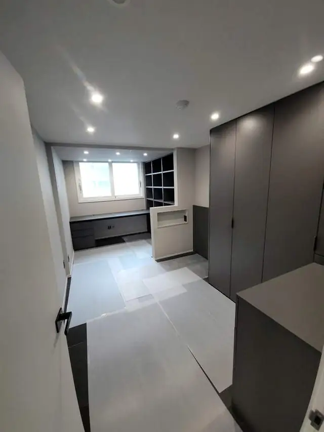
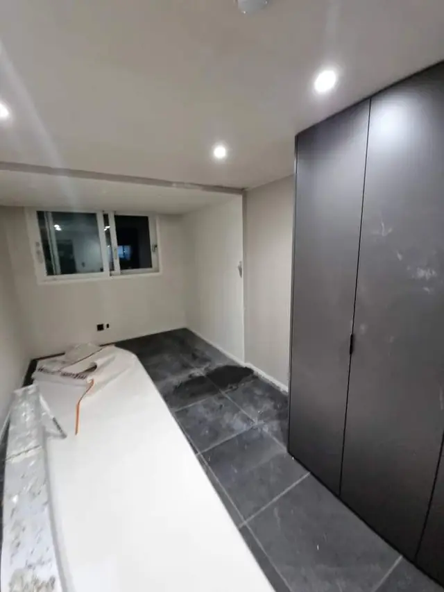

## 한 줄로 정리하면

- 붙박이장·가벽을 떼면 벽에 **나사 구멍, 앵커 자국, 본드 자국, 벽지 찢김**이 남아요.
- 철거만 하고 끝내면 다시 사람을 불러야 해서, **철거와 벽 복원을 한 번에** 하는 게 편해요.
- 철거 전에 **벽 속 전선·배관**이 지나가는지, 벽에 어떻게 고정됐는지 먼저 봐요.
- 벽지가 넓게 상하면 **부분 도배나 도장**까지 생각해야 해서 사진으로 범위를 미리 알려드려요.

## 철거하고 나면 벽에 뭐가 남나요?

붙박이장은 보통 벽과 천장에 **나사나 앵커로 고정**돼 있어요. 떼어내면 그 자리마다 구멍이 생기고, 오래 붙어 있던 부분은 주변과 **벽지 색이 달라요.** 본드로 붙인 곳은 떼면서 벽지가 같이 뜯기기도 하고, 가벽을 뜯으면 바닥과 천장에 **고정했던 자국과 틈**이 남아요. 붙박이장 뒤쪽은 공기가 안 통해서 **곰팡이나 얼룩**이 보이는 경우도 있어요.

## 철거 전에 확인할 것

1. 붙박이장 안이나 뒤에 **콘센트·스위치·조명**이 있는지
2. 가벽이라면 그 안으로 **전선이나 배관**이 지나가는지
3. 벽에 **나사로 고정**됐는지, **본드로 붙었는지**
4. 철거 뒤 그 자리를 **어떻게 쓸지** (침대·책상을 둘지, 그냥 비워 둘지)
5. **엘리베이터**가 있는지, 나온 자재를 어떻게 내릴지

마지막 두 가지에 따라 복원 범위와 작업 시간이 달라져요. 아파트 관리 규정상 작업 시간이 정해진 곳도 있으니 미리 확인해 주세요.

## 벽 복원은 어디까지 하나요?

- **나사·앵커 구멍:** 메우고 평평하게 정리해요. 작은 구멍은 [벽 구멍 메우기](/repair/wall-hole/)처럼 티가 거의 안 나게 돼요.
- **본드 자국·뜯긴 벽지:** 들뜬 부분을 정리하고, 좁으면 부분 보수, 넓으면 [벽지 부분 보수](/blog/wallpaper-tear-patch/)나 [부분 도장](/blog/partial-paint-door-wall/)을 같이 봐요.
- **바닥·천장 고정 자국:** 가벽 자리의 틈과 자국을 메우고 정리해요.
- **곰팡이·얼룩:** 닦아낼 수 있는지 먼저 보고, 벽지 속까지 번졌으면 그 부분을 따로 말씀드려요.

실제 작업은 [집 부분 철거 사례](/cases/demolition-224409040170/)에서 볼 수 있어요.

## 한눈에 비교

| 철거 대상 | 주로 남는 자국 | 복원 작업 |
| --- | --- | --- |
| 붙박이장 | 나사·앵커 구멍, 벽지 색 차이 | 구멍 메움, 필요하면 부분 도배 |
| 가벽 | 바닥·천장 고정 자국, 틈 | 자국 메움, 마감 정리 |
| 벽걸이 수납장·선반 | 앵커 구멍 | 구멍 메움 |
| 본드로 붙인 장 | 벽지 뜯김 | 부분 도배·도장 |
| 이사 나갈 때 원상복구 | 위 자국 전부 | 철거 + 복원 한 번에 |

## 사진 찍을 때 이렇게 찍어 주세요

- 철거할 **붙박이장·가벽 전체**가 보이게 한 장
- 벽·천장에 **닿는 부분**을 가까이서 한 장
- 안쪽에 **콘센트·조명**이 있으면 그 부분 한 장
- 철거 뒤 그 자리를 **어떻게 쓰고 싶은지** 한 줄 적어 주세요

## 자주 묻는 질문

### 떼어내기만 하고 끝나나요?
아니요. 떼어낸 자리의 구멍과 자국까지 정리하고, 나온 자재도 정리해서 가져가요. 양이 많으면 미리 말씀드려요.

### 장롱을 이사 가는 집으로 옮기고 싶으면요?
해체해서 다시 조립하는 방법은 [장롱 해체·조립](/blog/wardrobe-dismantle-move/) 글에 정리해 뒀어요.

### 이사 나갈 때 원상복구로도 되나요?
네. 세입자가 달았던 수납장·선반을 떼고 벽을 정리하는 작업도 많이 해요. [원상복구](/k/moveout-restore/) 페이지도 참고해 보세요.

### 견적은 어떻게 받나요?
철거할 곳 사진과 동네를 문자(010-3051-8015)로 보내 주시면 철거·복원 범위와 예상 금액을 먼저 알려드려요. 서울 전 구, 경기 전 시·군, 그 밖의 지역도 출장 가요. 자세한 내용은 [붙박이장 철거](/repair/closet-removal/) 페이지에서 볼 수 있어요.
