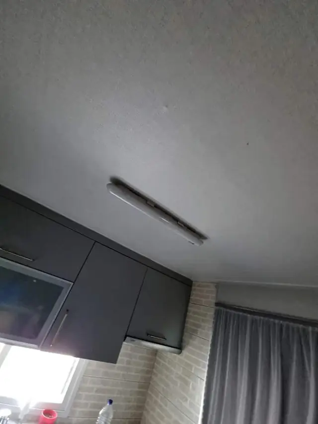
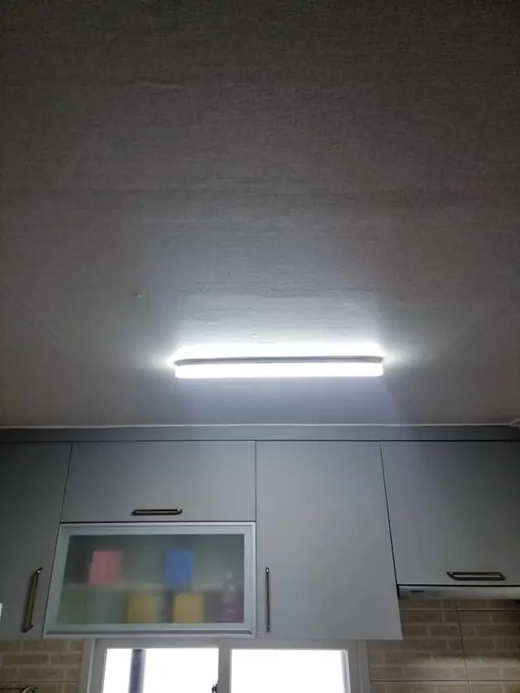

## 한 줄로 정리하면

- 형광등이 깜빡일 때 **새 형광등으로 바꿔도 그대로면** 등기구 안의 부품(안정기 등)이 낡은 경우가 많아요.
- 등기구가 오래됐다면 부품을 찾아 고치는 것보다 **LED 등으로 통째 바꾸는 쪽**이 깔끔해요.
- 새 등은 **예전 등 크기와 천장 자국**을 생각해서 골라야 바꾼 뒤 자국이 드러나지 않아요.
- 전기선을 다루는 일이라 **차단기를 내리고** 작업하는 게 기본이에요. 높거나 무거운 등은 맡기시는 게 안전해요.

## 깜빡임, 전구 문제일까 등기구 문제일까?

먼저 가장 쉬운 것부터 확인해 보세요.

1. **형광등(또는 램프)만 새것으로 바꿔 본다** → 깜빡임이 멈추면 램프 수명이 다한 거예요.
2. **새 램프로 바꿨는데도 깜빡이거나 늦게 켜진다** → 등기구 안쪽 부품이 낡은 경우가 많아요.
3. **등 커버 안쪽이 누렇게 변했거나, 탄 냄새·지지직 소리가 난다** → 바로 끄고 등기구를 바꾸는 게 좋아요.
4. **스위치를 꺼도 희미하게 빛이 남는다** → 스위치나 배선 쪽도 같이 봐야 해요.

## 왜 LED 등으로 통째 바꾸나요?

오래된 형광등 등기구는 부품을 따로 구하기도 번거롭고, 하나를 고쳐도 다른 부품이 곧 말썽을 부리는 경우가 많아요. LED 등기구로 바꾸면 램프를 따로 갈 일이 거의 없고, 켜자마자 밝게 들어와요. 주방은 칼질과 설거지를 하는 곳이라 **손 위쪽이 그늘지지 않는 밝기**가 중요해서, 어두운 형광등을 LED로 바꾸는 요청이 특히 많아요.

[마포구 주방 전등 교체 사례](/cases/kitchen-224416408778/)도 이렇게 오래된 형광등을 떼고 LED 등으로 바꿔 달았어요.

## 새 등을 고르기 전에 재 둘 것

등을 먼저 사 두셨다가 크기가 안 맞아 곤란해지는 경우가 있어요.

- **예전 등의 가로·세로 크기**: 새 등이 더 작으면 예전 등 자리에 변색된 자국이나 나사 구멍이 드러날 수 있어요.
- **천장에서 전선이 나오는 위치**: 새 등의 고정판이 이 자리를 덮을 수 있어야 해요.
- **천장 재질**: 석고보드인지, 나무 반자인지에 따라 고정하는 방법이 달라요.
- **주방 상부장과의 거리**: 상부장 문이 열릴 때 등에 걸리지 않는지 봐요.

등은 직접 사셔도 되고, 사진을 보고 자리에 맞는 크기와 형태를 말씀드릴 수도 있어요.

## 교체는 이런 순서로 해요

1. 차단기를 내리고 전기가 안 들어오는지 확인
2. 예전 등기구를 떼고 천장 상태 확인
3. 새 등 고정판을 천장에 단단히 고정하고 전선 연결
4. 등을 달고 켜 본 뒤, 깜빡임·밝기·스위치 동작 확인
5. 떼어 낸 등과 포장재 정리

예전 등을 떼고 나서 천장에 큰 구멍이나 자국이 남으면 등 크기로 덮거나 보수해서 마무리해요. 벽·천장 구멍은 [벽 구멍 복원 안내](/repair/wall-hole/)를 참고하세요.

## 한눈에 비교

| 상황 | 이렇게 하면 돼요 |
| --- | --- |
| 새 램프로 바꾸니 깜빡임이 멈춤 | 램프 교체로 끝 |
| 새 램프로 바꿔도 깜빡임·늦게 켜짐 | 등기구를 LED로 교체 |
| 커버가 누렇게 변함, 탄 냄새·소리 | 바로 끄고 등기구 교체 |
| 스위치를 꺼도 희미하게 켜짐 | 스위치·배선까지 같이 확인 |

## 사진 보내실 때 준비할 것

1. 지금 달린 **등 전체 사진**(커버를 씌운 상태로)
2. 등이 달린 **천장과 주변**(상부장, 벽)이 보이는 사진
3. 바꾸고 싶은 **등 개수**와 위치(주방, 거실, 방, 현관 등)
4. 이미 사 둔 등이 있으면 그 **제품 사진이나 이름**

## 자주 묻는 질문

### 등 하나만 바꿔도 불러도 되나요?
네, 하나도 괜찮아요. 오신 김에 다른 방이나 현관 등까지 한 번에 바꾸시는 분도 많아요.

### 현관 센서등도 같이 바꿀 수 있나요?
네. 계속 켜져 있거나 안 켜지는 현관 센서등도 같이 바꿔 드려요. [현관 센서등 교체](/k/sensor-light/) 페이지를 참고하세요.

### 화장실 등도 LED로 바꿀 수 있나요?
네. 화장실은 습기가 많은 곳이라 그 자리에 맞는 등으로 골라 달아요. 다른 현장은 [전등 교체 출장](/k/light-replace/) 페이지에서 볼 수 있어요.

### 견적은 어떻게 받나요?
등 사진 1~2장과 동네를 문자(010-3051-8015)로 보내 주시면 교체 방법과 예상 금액을 먼저 알려드려요. 서울 전 구, 경기 전 시·군은 물론 다른 지역도 일정을 맞춰 출장 가요.
