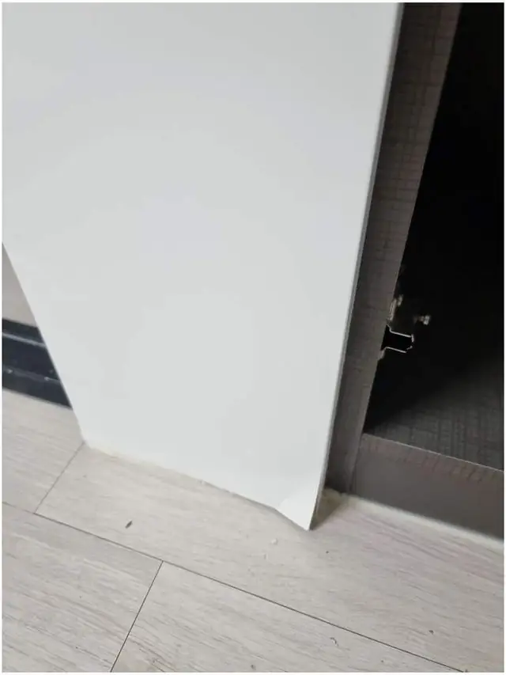
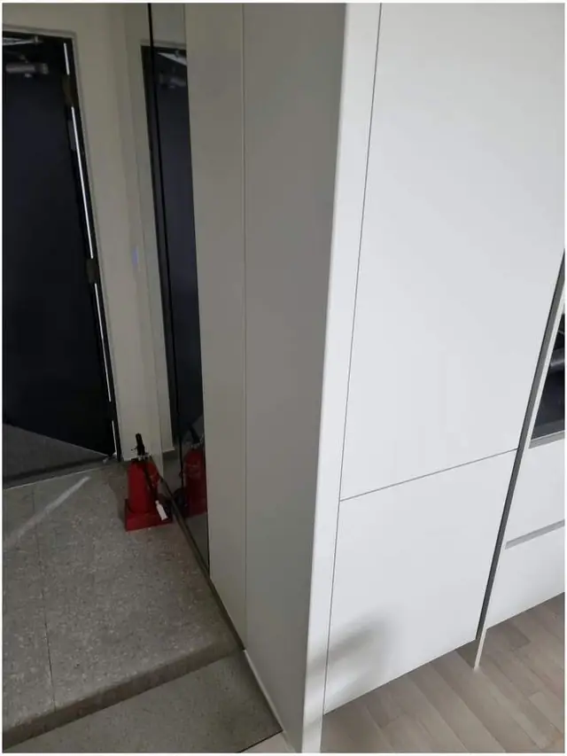

## 한 줄로 정리하면

- 문과 문틀이 **멀쩡히 열리고 닫히는데 겉면만 낡았다면** 교체 대신 **필름 시공**으로 새것처럼 바꿀 수 있어요.
- 모서리가 **깨지거나 표면이 들뜬 곳**은 필름을 붙이기 전에 **먼저 보수**해야 들뜸 없이 붙어요.
- 문이 처지거나 안 닫히는 문제는 필름으로 해결되지 않으니 **경첩이나 문틀부터** 손봐야 해요.
- 방문·문틀·현관문·붙박이장 문까지 **색을 맞춰 같이 하면** 집 분위기가 한 번에 바뀌어요.

## 필름 시공이 잘 맞는 경우는?

이런 상태라면 필름으로 충분히 깔끔해져요.

1. 문 색이 **누렇게 바래거나** 무늬가 촌스러워 보일 때
2. 문과 문틀에 **잔기스, 얼룩, 낙서**가 많을 때
3. 이사 들어가기 전에 **집 분위기를 바꾸고** 싶은데 공사는 크게 하기 싫을 때
4. 전월세 집을 정리하면서 **문 상태를 깔끔하게** 돌려놓고 싶을 때

문짝을 떼서 새로 사는 것보다 공사가 작고, 문틀까지 같은 색으로 맞출 수 있는 게 장점이에요.

## 문틀이 깨지고 들떴는데도 필름이 되나요?

됩니다. 다만 순서가 중요해요. 깨진 모서리나 들뜬 표면 위에 바로 필름을 붙이면 그 모양이 그대로 비치고, 얼마 안 가 다시 들떠요. 그래서 **손상된 표면을 먼저 정리하고 메운 뒤** 필름을 감싸요.

위 사진은 실제로 깨지고 들뜬 문틀을 보수한 뒤 필름으로 마감한 현장이에요. 자세한 작업 순서는 [문틀 필름 시공 사례](/cases/door-224372308194/)에 있어요.

## 필름으로 안 되는 경우도 있어요

- **문이 처지거나 안 닫힐 때**: 겉면 문제가 아니라 경첩·나사 구멍 문제라서, [문 경첩 수리](/repair/door-hinge/)를 먼저 해야 해요.
- **물에 젖어 부풀거나 썩었을 때**: 화장실 문 아래처럼 속까지 상했으면 필름을 붙여도 다시 들떠요. 이럴 땐 상한 부분을 보수하거나 문짝 교체를 고민해야 해요.
- **문짝이 뒤틀렸을 때**: 닫았을 때 틈이 고르지 않으면 필름으로는 바로잡을 수 없어요.

## 한눈에 비교

| 방법 | 이런 경우에 맞아요 | 아쉬운 점 |
| --- | --- | --- |
| 필름 시공 | 겉면만 낡거나 색을 바꾸고 싶을 때 | 깨진 곳은 먼저 보수해야 함 |
| 부분 보수 후 필름 | 모서리가 까지고 들뜬 문틀 | 손상이 심하면 보수 범위가 커짐 |
| 문짝 교체 | 젖어 썩었거나 뒤틀린 문 | 문틀과 색·규격을 맞춰야 함 |

## 사진 보내실 때 준비할 것

1. 문과 문틀 **전체**가 보이게 찍은 사진
2. **까지거나 들뜬 부분**을 가까이 찍은 사진
3. 같이 하고 싶은 **다른 문 개수**(방문, 현관문, 붙박이장 문 등)
4. 원하시는 **색이나 느낌**(예: 밝은 화이트, 나무 무늬)

## 자주 묻는 질문

### 문을 떼지 않고 그대로 붙이나요?
네, 대부분 문은 그대로 두고 필름만 입혀요. 문틀과 문을 같이 하면 색이 맞아 더 깔끔해요.

### 싱크대 문이나 샷시도 같이 되나요?
네. 싱크대 문짝, 붙박이장, 샷시 문틀도 필름으로 많이 리폼해요. [문 필름 시공](/k/door-film/), [인테리어 필름 시공](/k/interior-film/) 페이지에서 다른 작업도 볼 수 있어요.

### 문이 안 닫히는 것도 같이 고쳐 주시나요?
네. 필름을 붙이기 전에 경첩이나 문틀 상태를 같이 보고, 손봐야 할 곳이 있으면 함께 정리해요.

### 견적은 어떻게 받나요?
문과 문틀 사진 1~2장, 문 개수와 동네를 문자(010-3051-8015)로 보내 주시면 시공 방법과 예상 금액을 먼저 알려드려요. 서울 전 구, 경기 전 시·군은 물론 다른 지역도 일정을 맞춰 출장 가요.
