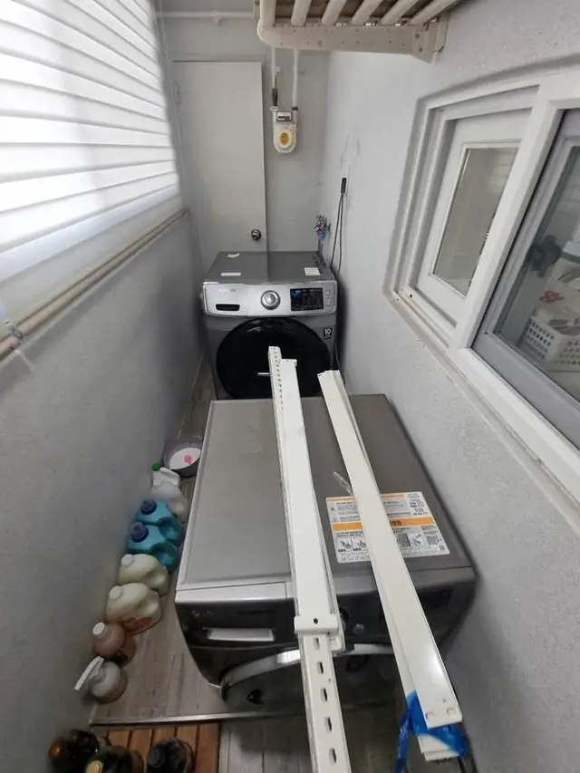
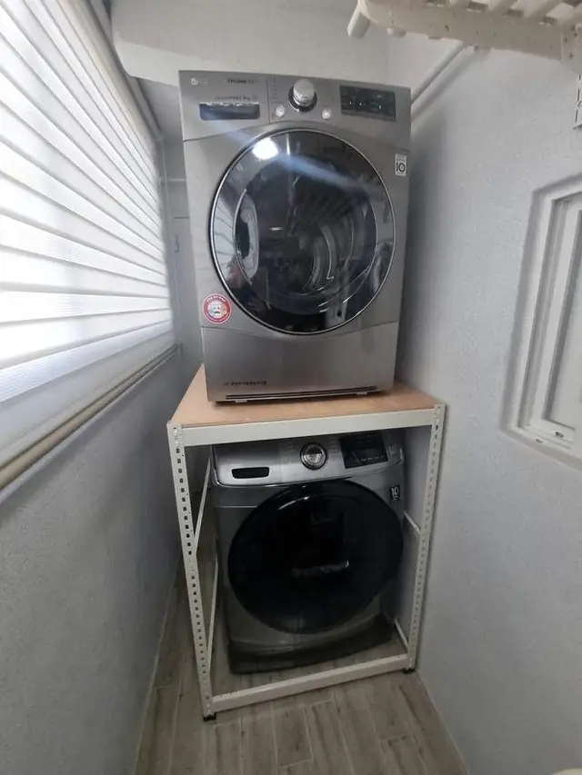

## 한 줄로 정리하면

- 건조기 자리는 보통 **세탁기 위, 세탁기 옆, 다용도실, 베란다** 중에서 골라요.
- 자리를 정할 때는 넓이보다 **콘센트, 물 빠질 곳, 뒤쪽 바람길, 문 열림** 네 가지를 먼저 봐요.
- 세탁실이 좁으면 **세탁기 위로 올리는 방법**(건조기랙·선반·직렬 키트)이 가장 많이 쓰여요.
- 바깥 베란다는 **겨울에 물이 얼 수 있어서** 배수 호스와 물통 관리를 미리 생각해야 해요.

## 건조기는 어디에 많이 두나요?

**1. 세탁기 위**
세탁실 바닥이 좁은 집에서 가장 많이 고르는 자리예요. 세탁기와 건조기 브랜드·모델이 맞으면 직렬 키트로 올리고, 안 맞거나 통돌이 세탁기 위라면 건조기랙이나 선반을 세워서 올려요. 차이는 [건조기 받침대 vs 건조기 랙](/blog/dryer-stand-vs-rack/) 글에 정리해 두었어요.

**2. 세탁기 옆**
폭이 넉넉하면 나란히 두는 게 쓰기 편해요. 대신 두 대가 들어갈 폭 말고도 **양옆 틈과 문 열 자리**가 더 필요해요.

**3. 다용도실·보일러실 옆**
기존 수납장이나 선반을 떼면 자리가 나오는 경우가 많아요. 남는 벽 자국까지 정리하는 방법은 [다용도실 수납장 떼고 건조기 자리 만들기](/blog/utility-room-cabinet-remove/)를 참고하세요.

**4. 베란다**
공간은 넓지만 겨울철 추위와 습기를 꼭 생각해야 해요. 아래에서 따로 설명할게요.

위 사진은 바닥에 건조기 둘 자리가 없어서 선반을 짜 넣고 위로 올린 현장이에요. 순서는 [좁은 세탁실 건조기 선반 사례](/cases/laundry-224394538563/)에 있어요.

## 자리 정하기 전에 꼭 볼 네 가지

**콘센트**
건조기는 전기를 많이 쓰는 가전이라 **멀티탭에 꽂지 말고 벽 콘센트에 바로** 꽂는 게 좋아요. 위로 올릴 때는 플러그가 닿는지도 봐야 해요. 콘센트가 멀거나 헐거우면 [콘센트 교체](/k/outlet-replace/)도 같이 할 수 있어요.

**물 빠질 곳**
요즘 건조기는 대부분 옷에서 나온 물을 **물통에 모으거나 배수 호스로 빼요.** 배수구 가까운 자리라면 호스로 빼 두면 물통 비우는 일이 없어요.

**뒤쪽 바람길**
벽에 너무 바짝 붙이면 열이 빠지지 않아요. 설치 설명서에 나온 **뒤쪽·옆쪽 띄울 간격**을 지켜 주세요.

**문 열림 방향**
건조기 문이 벽이나 세탁실 문에 막히면 빨래를 꺼내기 불편해요. 모델에 따라 **문 방향을 바꿀 수 있는** 제품도 있으니 설명서를 확인해 보세요.

## 바깥 베란다에 둬도 될까요?

둘 수는 있지만 **겨울에 조심할 점**이 있어요. 영하로 내려가는 베란다에서는 배수 호스나 물통에 남은 물이 얼 수 있고, 얼었다 녹으면서 물이 샐 수 있어요. 바깥 베란다에 두신다면 호스를 짧고 처지지 않게 정리하고, 추운 날에는 물통을 비워 두는 게 좋아요. 비나 습기가 직접 닿는 자리는 피하세요.

## 한눈에 비교

| 자리 | 좋은 점 | 미리 확인할 것 |
| --- | --- | --- |
| 세탁기 위 | 바닥 공간을 안 써요 | 천장 높이, 랙·키트 종류, 벽 재질 |
| 세탁기 옆 | 넣고 빼기 편해요 | 두 대 폭 + 양옆 틈, 문 열림 |
| 다용도실 | 세탁실이 좁아도 돼요 | 기존 장·선반 철거, 콘센트 |
| 베란다 | 공간이 넓어요 | 겨울 동결, 습기, 배수 |

## 준비할 것

1. 건조기와 세탁기 **모델명**(또는 제품 사진)
2. 둘 자리 **정면 사진**과 **천장까지 나오는 사진**
3. 자리의 **폭·깊이·천장 높이**
4. 콘센트와 배수구가 보이는 사진

## 자주 묻는 질문

### 통돌이 세탁기 위에도 건조기를 올릴 수 있나요?
네. 통돌이는 뚜껑이 위로 열려서 바로 올릴 수 없고, 뚜껑 열 높이를 남기고 **랙이나 선반**을 세워서 올려요. [세탁기 위 건조기](/k/dryer-on-washer/) 페이지에 사례가 있어요.

### 전월세라 벽에 구멍을 내기 싫어요.
벽에 안 박고 세우는 방식도 있어요. [벽에 구멍 안 내고 건조기 올리기](/blog/no-drill-dryer-rack-rent/) 글을 보세요.

### 이사 가서 자리가 바뀌면 다시 해 주시나요?
네. 새 집 자리에 맞게 다시 설치해요. [세탁기·건조기 이전](/k/washer-dryer-move/) 페이지를 참고하세요.

### 견적은 어떻게 받나요?
둘 자리 사진 1~2장과 제품 모델명, 동네를 문자(010-3051-8015)로 보내 주시면 어떤 방법이 맞는지와 예상 금액을 먼저 알려드려요. 서울 전 구, 경기 전 시·군은 물론 다른 지역도 일정을 맞춰 출장 가요.
