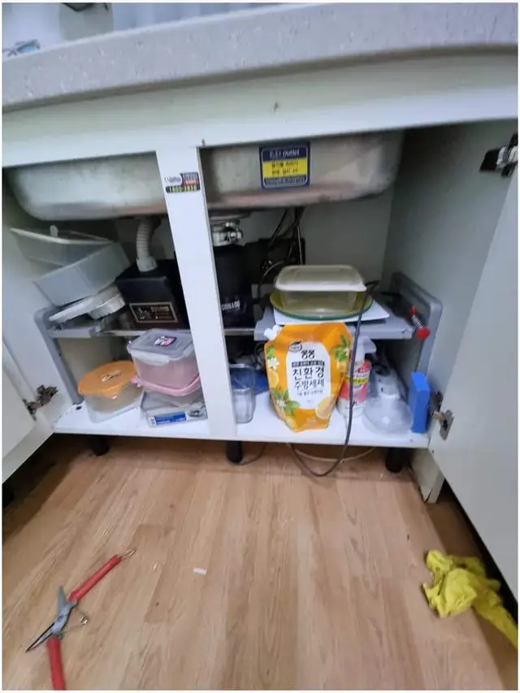
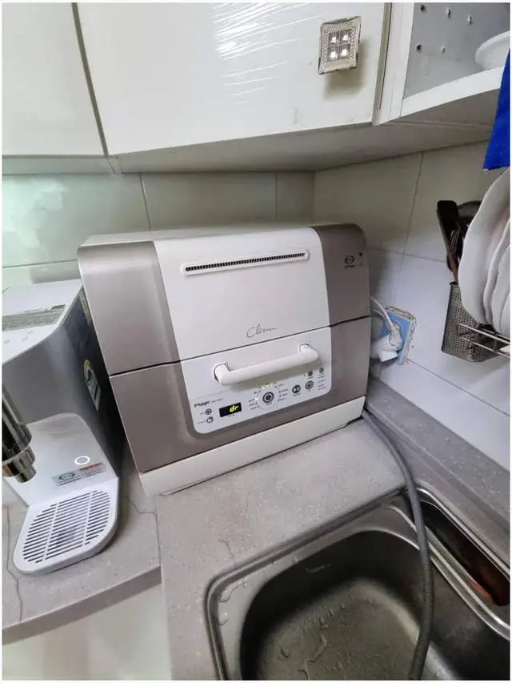

## 한 줄로 정리하면

- 식기세척기는 **싱크볼 바로 옆 칸**에 두는 게 가장 좋아요. 급수·배수가 가까워 물이 잘 빠지고 연결도 깔끔해요.
- 왼쪽이냐 오른쪽이냐는 **설거지하는 순서**(그릇을 헹구는 손, 그릇 둘 곳)에 맞춰 정해요.
- **코너 칸**은 문이 다 안 열리거나 옆 서랍과 부딪힐 수 있어서 피하는 게 좋아요.
- 자리가 애매하면 주방 사진만으로 **어느 칸이 맞는지 먼저** 봐 드려요.

## 왜 싱크볼 옆이 좋을까요?

식기세척기는 **싱크대 아래 배관에서 물을 받고, 같은 배수구로 물을 빼요.** 싱크볼과 멀어지면 배수 호스가 길어지고, 호스가 길면 중간에 처지거나 꺾여서 물이 잘 안 빠질 수 있어요. 그래서 대부분 **싱크볼 바로 옆 하부장 한 칸**을 비워 넣어요.

또 하나, 헹군 그릇을 바로 옆으로 옮겨 넣을 수 있어서 **주방 바닥에 물이 덜 떨어져요.**

## 왼쪽, 오른쪽은 어떻게 정하나요?

정답은 없고 **평소 설거지하는 방향**을 떠올려 보세요.

- 그릇을 왼쪽에 쌓아 두고 오른쪽으로 헹궈 내려놓는 분이라면 **오른쪽**이 편해요.
- 반대로 하시는 분이라면 **왼쪽**이 편해요.
- 한쪽 옆이 바로 벽이거나 냉장고라면, 문이 다 열리는 **반대쪽**이 좋아요.

문을 열었을 때 내가 서 있을 자리가 막히지 않는지도 같이 봐 주세요. 문이 열린 채로 싱크대 앞에 서기 어려우면 매번 불편해요.

## 피하면 좋은 자리

**코너 칸**
ㄱ자 주방 꺾이는 곳은 옆 하부장 문이나 손잡이와 부딪혀 **식기세척기 문이 끝까지 안 열리는** 일이 많아요.

**서랍장 칸**
서랍장도 뺄 수는 있지만 레일과 칸막이를 떼고 정리하는 작업이 더 들어요. 일반 문짝 칸이 있으면 그쪽이 수월해요.

**가스레인지·오븐 바로 아래**
쿡탑 아래는 보통 자리가 없거나 열이 나는 곳이라 맞지 않아요. 안 쓰는 오븐 자리라면 얘기가 달라요. [오븐 자리에 식기세척기 넣기](/blog/oven-to-dishwasher-swap/) 글을 참고하세요.

하부장을 건드리기 어려운 집은 위 사진처럼 **싱크대 옆 상판 위에 6인용**을 두기도 해요. 순서는 [동탄 상판형 식기세척기 사례](/cases/kitchen-224335005143/)에 있어요.

## 한눈에 비교

| 자리 | 괜찮은 경우 | 주의할 점 |
| --- | --- | --- |
| 싱크볼 바로 옆 칸 | 대부분의 주방 | 칸 폭·높이가 제품과 맞는지 |
| 싱크볼에서 한 칸 건너 | 바로 옆이 서랍장·코너일 때 | 배수 호스 길이와 처짐 |
| 코너 칸 | 거의 권하지 않아요 | 문 열림, 옆 손잡이 부딪힘 |
| 상판 위(6인용) | 하부장을 비우기 어려울 때 | 상판 위 공간, 호스 정리 |

## 준비할 것

1. 식기세척기 **모델명**(빌트인·프리스탠딩·6인용)
2. **싱크대 전체 사진**과 **싱크대 아래 배관 사진**
3. 넣고 싶은 칸의 **폭·높이·깊이**
4. 근처 **콘센트 위치**가 보이는 사진

## 자주 묻는 질문

### 싱크대를 안 바꾸고 하부장 한 칸만 비워도 되나요?
네. 대부분 그렇게 해요. [싱크대 안 바꾸고 식기세척기 넣기](/blog/sink-dishwasher-no-replace/) 글과 [하부장 빌트인 사례](/cases/kitchen-224369216537/)를 보세요.

### 근처에 콘센트가 없어요.
식기세척기 자리에 콘센트를 연결하는 작업도 같이 해요. [콘센트 교체](/k/outlet-replace/) 페이지를 참고하세요.

### 빌트인과 6인용 중 뭘 사야 할지 모르겠어요.
주방 크기와 식구 수에 따라 달라요. [빌트인·프리스탠딩·6인용 비교](/blog/dishwasher-builtin-guide/) 글에 정리해 두었어요.

### 견적은 어떻게 받나요?
싱크대 사진 1~2장과 모델명, 동네를 문자(010-3051-8015)로 보내 주시면 어느 칸이 맞는지와 예상 금액을 먼저 알려드려요. 서울 전 구, 경기 전 시·군은 물론 다른 지역도 일정을 맞춰 출장 가요.
