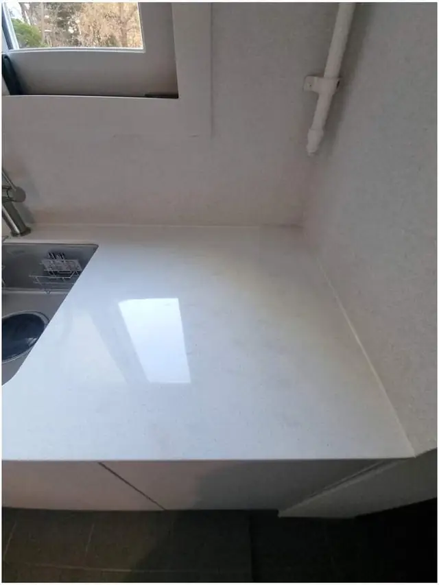
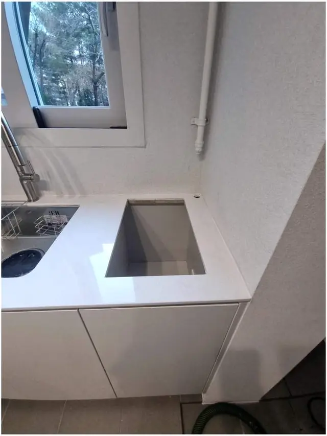

## 한 줄로 정리하면

- 인덕션은 **제품 소비전력**에 따라 집에 있는 콘센트로 바로 쓸 수도 있고, **전용 선과 차단기**가 따로 필요할 수도 있어요.
- 먼저 **제품 설명서의 소비전력과 전원 조건**을 보고, 싱크대 아래 콘센트와 분전함 차단기를 확인해요.
- 인덕션은 **멀티탭에 꽂으면 안 돼요.** 벽 콘센트나 전용 전원에 바로 연결해요.
- 가스레인지를 뗀 뒤 남은 **가스 배관 마감**은 도시가스 회사에 요청해요.

## 왜 전기 확인이 먼저일까요?

가스레인지는 불을 가스로 만들지만, 인덕션은 **전기로 열을 내요.** 그래서 화구를 여러 개 동시에 세게 쓰면 전기를 많이 끌어 써요. 집의 전선과 차단기가 그만큼을 감당하지 못하면 **요리 중에 차단기가 떨어지거나** 콘센트가 뜨거워질 수 있어요.

특히 **3구 이상 인덕션**이나 화력이 센 제품은 전용 선이 필요하다고 설명서에 적혀 있는 경우가 많아요. 반대로 1구·2구 소형 제품은 일반 콘센트로 쓰는 제품도 있어요.

## 우리 집에서 확인하는 순서

**1. 제품 설명서 보기**
사려는 인덕션의 **소비전력(정격 전력)**과 **전원 연결 방식**(플러그형인지, 전선을 직접 연결하는 방식인지)을 확인해요. 이게 가장 정확한 기준이에요.

**2. 싱크대 아래 콘센트 보기**
쿡탑 자리 아래 하부장 안에 콘센트가 있는지, 있다면 **헐겁거나 그을린 자국**은 없는지 봐요. 오래된 콘센트는 [콘센트 교체](/k/outlet-replace/)로 새것으로 바꿀 수 있어요.

**3. 분전함 차단기 보기**
현관이나 신발장 쪽 분전함을 열면 차단기마다 이름표가 붙어 있어요. **주방 전용, 인덕션 전용** 차단기가 따로 있는지 확인해 보세요. 최근 지은 아파트는 인덕션용 전원이 미리 준비된 곳도 있어요.

**4. 같은 선에 다른 가전이 있는지**
전자레인지, 식기세척기, 전기밥솥이 같은 차단기에 묶여 있으면 동시에 쓸 때 떨어지기 쉬워요.

## 전용 선이 필요하다고 나오면?

설명서상 전용 선이 필요한데 집에 준비가 안 돼 있으면, 분전함에서 쿡탑 자리까지 **새로 선을 끌어오는 전기 공사**가 필요해요. 이 경우 사진을 보고 미리 말씀드리고, 상판 자르기·매립 일정과 순서를 맞춰요. 전기 준비가 끝나기 전에 상판부터 잘라 두면, 제품이 오는 날 설치를 바로 끝낼 수 있어요.

위 사진은 가스레인지를 떼고 인덕션이 오기 전에 대리석 상판을 규격대로 잘라 둔 현장이에요. [강남구 인덕션 매립 자리 만들기 사례](/cases/kitchen-224359030070/)에서 순서를 볼 수 있어요.

## 가스레인지 뗀 자리, 가스는 어떻게 하나요?

가스레인지를 떼면 벽이나 하부장 안에 **가스 배관과 밸브**가 남아요. 이 배관을 막는 마감은 **사는 지역 도시가스 회사 고객센터**에 요청하시면 돼요. 가스 쪽 정리가 끝나야 상판을 자르고 인덕션을 넣는 작업을 안심하고 할 수 있어요.

## 한눈에 비교

| 상황 | 이렇게 해요 |
| --- | --- |
| 소형(1~2구), 설명서상 일반 콘센트 가능 | 쿡탑 아래 콘센트 상태만 확인하고 설치 |
| 인덕션 전용 차단기·전원이 이미 있음 | 상판 자르기·매립 후 바로 연결 |
| 3구 이상, 전용 선 필요한데 준비 안 됨 | 전기 공사 먼저, 상판은 미리 잘라 둘 수 있음 |
| 쓰던 가스레인지 철거 | 가스 배관 마감은 도시가스 회사에 요청 |

## 준비할 것

1. 인덕션 **모델명**과 설명서의 **전원 조건** 사진
2. 쿡탑 자리 **상판 사진**과 **하부장 안 콘센트 사진**
3. **분전함 차단기** 이름표가 보이는 사진
4. 원하는 **설치 날짜**(제품 배송일)

## 자주 묻는 질문

### 상판 구멍이 인덕션과 안 맞으면요?
구멍을 넓히거나, 너무 크면 메워서 다시 맞춰요. [가스레인지를 인덕션으로 바꿀 때 상판 구멍](/blog/induction-countertop-cut/) 글을 보세요.

### 대리석 상판도 자를 수 있나요?
네. 인조대리석, 천연석 상판 모두 작업해요. [인덕션 자리 자르기](/repair/induction-cut/)와 [인덕션 설치](/k/induction-install/) 페이지에 사례가 있어요.

### 하이라이트나 전기레인지도 같은가요?
전기로 쓰는 제품이라 전원 확인은 똑같이 필요해요. [전기레인지 설치](/k/electric-range/) 페이지를 참고하세요.

### 견적은 어떻게 받나요?
상판 사진과 하부장 안 콘센트 사진, 인덕션 모델명, 동네를 문자(010-3051-8015)로 보내 주시면 전기 쪽 확인할 점과 예상 금액을 먼저 알려드려요. 서울 전 구, 경기 전 시·군은 물론 다른 지역도 일정을 맞춰 출장 가요.
